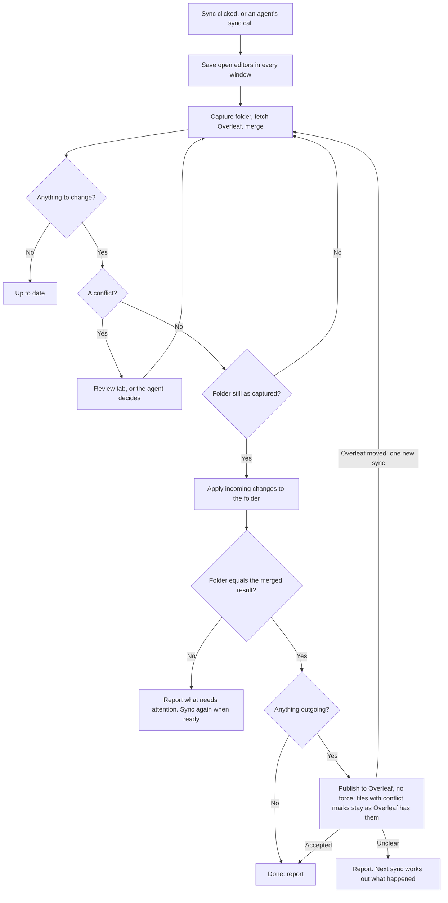

# Scient ↔ Overleaf: implementation plan (revision 5)

Written October 2, 2026; implementation boundaries refreshed October 11. Status: **approved by the owner on October 2, 2026, as the working plan; it can still change.** D8 was answered yes. The engine and retained local applier have since landed, including PR #486. The [PR B transition and ownership contract](pr-b-coordinator-contract.md) refines this plan for the coordinator. **October 24: the owner's product and agent decisions are in [pr-c-design.md](pr-c-design.md).** They replace D4 and update sections 1, 4, 5, 6, 8 and 10; where any text still disagrees, that document wins.

**Order with live sync (agreed October 4, 2026).** This feature ships first. Live sync, planned separately and not part of this delivery, follows and reuses four things built here, so they are designed for both: the file replacement method (4.6), the connection record with a mode (4.8), pausing for checkpoint restores (4.6), and the review tab (PR C2).

Earlier revisions folded in three rounds of independent review, an executable model of the sync rules and a filesystem prototype; section 2 summarises what they established. The original assessment used main `feedb89068` and PR #121 head `3bdf7486fc`; those are historical references. The October 11 coordinator contract inspects main `988ceaa4d2cdf3311a77d84d6371c029971b52f9` and PR #495 head `45bcd84a741a231734d1d2524921aeb2e56f9e36`, incorporating the [completed Cloud findings](cloud-qualification.md). Refresh changed source owners before implementation; preserve the settled architecture.

## 1. What gets built

**A manual, two-way manuscript-file sync between one folder in a Scient project and one Overleaf project, over Overleaf's Git integration.** It behaves like a careful `git pull` followed by `git push`: Scient brings Overleaf's changes into the folder first, and then publishes exactly what is in the folder.

Included:

- Each Overleaf project in its own folder; a Scient project can hold several. Link a folder, or bring a project in as a new folder or a new Scient project, in five ways, one of them asking the agent ([pr-c-design.md](pr-c-design.md) sections 2–3).
- Sync on demand. Only a conflict stops it; everything else is done, then reported, with Undo.
- Conflicts: keep mine, use Overleaf's, merge in the editor, or ask the agent.
- Agent tools that can do everything a person can, under the composer's access setting and nothing else.
- Safe behaviour after a crash, a lost network response, or edits made during a sync.
- An Overleaf chip in file headers, settings under Source Control and Project Settings, and user, agent and internals documentation.

Not included (section 10): live collaboration, automatic background sync, generated-artifact ownership rules, one-time ZIP exchange for free Overleaf accounts.

**Who it serves.** On Overleaf Cloud, Git works on a project when either its owner has a paid plan or the person connecting does. Overleaf's own pages describe this inconsistently, so Scient applies no rule of its own: connecting tests real access to that project and reports what Overleaf answered.

**What is claimed as supported at release:** Overleaf Cloud, from the macOS desktop app. Server Pro, custom hosts, Windows and Linux remain unverified; this plan does not establish that their product paths are available. The first coordinator contract admits official Cloud endpoints; additional hosts need their own host policy and qualification.

## 2. How the rules were validated

The rules in section 4 are the result of three review rounds, an executable model of the sync rules (the "checker") and a filesystem prototype. Each rule below exists because a simpler version failed in a reproduced sequence:

| Rule                                                                                            | What failed without it                                                                                           |
| ----------------------------------------------------------------------------------------------- | ---------------------------------------------------------------------------------------------------------------- |
| Folder first; publish only a tree verified on disk                                              | Collaborators received a merged manuscript that never existed on the user's disk                                 |
| Structural changes create before they remove                                                    | A crash between deleting a rename's source and creating its destination lost the local edit                      |
| Durable publish-attempt record                                                                  | An accepted push followed by a collaborator's revert was re-published over the revert                            |
| Base advances per **file identity** (paths linked by renames), not per path                     | A failed write to a locally renamed file advanced the old name's base; the next sync removed a collaborator edit |
| Only undo what this apply recorded writing and is unchanged; equal content is not proof         | A hand-made rename identical to an incoming one was rolled back, deleting the user's file                        |
| One file identity or one conflict decision is one **unit**: all done, or interrupted as a whole | One decision half-applied; the next sync published the opposite of the user's choice                             |
| A file already gone at deletion time is **not done**                                            | A locally renamed file was sent back to Overleaf as a new file                                                   |
| Each finished step is recorded as done                                                          | An edit made right after an incoming write looked like a failed write and produced a needless conflict           |
| Conflict groups include rename counterparts                                                     | Choosing a side removed a collaborator's edit                                                                    |
| Atomic exchange for file replacement                                                            | Move-aside left the path empty for ~0.5–6 ms; a polling reader saw the file missing in many reads                |

With these rules, seven checker configurations completed with no violation (18,000 to 293,000 states each; the largest was stopped at 4.1 million states with none found). This is evidence within small bounds on Git 2.54, not a proof. The planner guard (section 4.2) was not needed within those bounds; it stays as a second line of defence. The checker and prototype live outside this repository and are available on request.

## 3. Decisions

| #   | Decision                            | Default                                                                                                                                                                                                                                                                                                                                                                                                                                                                                                 |
| --- | ----------------------------------- | ------------------------------------------------------------------------------------------------------------------------------------------------------------------------------------------------------------------------------------------------------------------------------------------------------------------------------------------------------------------------------------------------------------------------------------------------------------------------------------------------------- |
| D1  | Scope                               | Manuscript-file sync only.                                                                                                                                                                                                                                                                                                                                                                                                                                                                              |
| D2  | Order                               | Folder first, then Overleaf. A workflow choice: a failed publish leaves you with a merged folder and unsent changes. It does not by itself prove the result compiles.                                                                                                                                                                                                                                                                                                                                   |
| D3  | Conflicts                           | Merge in editor for text, or ask the agent to merge; keep-mine and use-Overleaf's shortcuts; multi-file conflicts get those two choices for the whole group.                                                                                                                                                                                                                                                                                                                                            |
| D4  | Review (**changed October 24**)     | Only a conflict stops a sync. The Sync click, or an agent's sync call, is the confirmation; new files, deletions, renames and older versions are synced, then reported, with Undo. The review opens only for a conflict or on request.                                                                                                                                                                                                                                                                  |
| D5  | Git                                 | System Git, version 2.39 or newer, with a clear message otherwise.                                                                                                                                                                                                                                                                                                                                                                                                                                      |
| D6  | Delivery                            | Reviewable layers from current main. Engine/applier layers have landed; helper/probe #495 precedes PR B or is its explicit stack parent. PR #121 was closed on October 19 with thanks to Yishay Polatov.                                                                                                                                                                                                                                                                                                |
| D8  | File replacement (**decided: yes**) | Owned macOS atomic-exchange helper, packaged/signed through #495. Packaged macOS refuses a missing/incompatible required helper; it does not silently use move-aside. Explicit standalone/development fallback has a missing-path window and distinct recovery evidence.                                                                                                                                                                                                                                |
| D7  | Real-Overleaf test                  | Disposable Cloud protocol gate completed October 9 for the exercised cases; token was entered locally. Actual network loss remains unverified and does not block PR B's deterministic uncertain-outcome contract.                                                                                                                                                                                                                                                                                       |
| D10 | Folders (October 24)                | One Overleaf project, one dedicated folder; several per Scient project, never nested. A project made from Overleaf puts the paper in a subfolder.                                                                                                                                                                                                                                                                                                                                                       |
| D11 | Agents (October 24)                 | Agents can do whatever a person can. No Overleaf-specific permission, approval, confirmation or stop; the composer's access setting is the only control, and the tools never change it.                                                                                                                                                                                                                                                                                                                 |
| D12 | New files (October 24)              | Sent by default. Build leftovers, hidden files, Scient's own files and files over 50 MB are skipped by a rule each sync; "keep only on this computer" is a deliberate, reversible list.                                                                                                                                                                                                                                                                                                                 |
| D13 | Where it lives (October 24)         | Five ways to connect; an Overleaf chip in file headers; Settings ▸ Source Control ▸ Overleaf for the token and every link; Project Settings ▸ Overleaf for this project's links.                                                                                                                                                                                                                                                                                                                        |
| D14 | Order (October 24)                  | Step 5, then agent tools (PR C1), then the screens (PR C2), each with its documentation.                                                                                                                                                                                                                                                                                                                                                                                                                |
| D9  | Projects on another disk            | **Decided October 13: supported in v1.** Retained copies go in a hidden `.scient-overleaf` folder beside the checkout on the project's own disk, identified by volume UUID plus file ID. Refused with a specific reason: no readable volume UUID; no atomic exchange through the #495 helper (Mac OS Extended, exFAT and FAT32 tested and refused; only APFS is supported); no protected location ([contract section 8](pr-b-coordinator-contract.md#8-retention-disk-failures-and-inventory-budgets)). |

## 4. How a sync works

The client confirms the review it received at once unless it has a conflict, passing the engine's acknowledgements automatically. The engine's review, its acknowledgements and its validity rules are unchanged; only who answers them changed.

### 4.1 Trees and the merge

The private repository is bare; nothing is ever checked out. Each sync uses four trees:

| Tree   | Meaning                                                   |
| ------ | --------------------------------------------------------- |
| Base   | Per file, a version that both sides have already absorbed |
| Local  | Bytes captured from the folder for this sync              |
| Remote | Overleaf content just fetched                             |
| Merged | `git merge-tree` of Local and Remote over Base            |

The original throwaway-repository experiments used Git 2.54. The delivered engine/applier (#486) and helper increment (#495) subsequently passed focused qualification with Git 2.39.0; the evidence is recorded in those PRs. Those results qualify their recorded revisions, not the future coordinator. PR B exercises its complete service journey at the supported Git floor too.

### 4.2 Base, re-planning and renames

**Re-plan, do not partially apply.** Review takes time, and agents keep working. Before writing anything, Scient checks that every file it is about to change still matches the capture. If not, it writes nothing, captures again, and merges again against the Overleaf state it already fetched. If the new plan differs, the app or tool confirms the replacement itself unless it now has a conflict. This lets a file edited during review follow an incoming rename correctly; this was tested.

**Per-file base, for the partial case.** A file can still change between that check and its write. Then:

- A file that now holds the merged content takes Remote's version as its base.
- A file that was skipped keeps its old base.
- After an accepted publish, base becomes the published tree.

"A file" here means a **file identity**: its path locally, its path on Overleaf and its path in the base, linked by any rename on either side. Those paths advance or stay together. Advancing by path alone lost a collaborator's edit in the checker.

**Units.** All changes that touch one file identity, or that come from one conflict decision, form a unit. A unit is done only if every part is. A unit that is partly on disk is recorded as interrupted as a whole.

**Only undo what is provably ours.** The engine removes or takes back a file only if this apply's record says it wrote that file and the content is unchanged. A file that merely equals what the engine intended may be your own work.

**Already gone is not done.** If a file to be removed is already missing, someone else deleted or renamed it. The engine leaves the base alone so the next merge sees their action.

**Structural changes are applied as a group, and content is created before anything is removed.** A rename, a folder move, or a file replaced by a folder is one group. For each group:

1. Check that every source file still matches the capture. If not, skip the whole group and leave its base untouched; the next sync carries the edit into the renamed file.
2. Write the destinations, and record that they were written.
3. Remove the sources, re-checking each. If a source changed or vanished in the meantime, take the destination back (it is provably ours) and skip the group.

When a destination cannot exist until a source is gone (a file becoming a folder of the same name), the source is moved aside under a temporary name first and removed last. At no point during a group are the bytes absent from the folder. An earlier revision deleted first; a crash at that moment lost the local edit from the folder (reproduced).

The base for a group advances only when the whole group is done.

**Why the base must never lag behind a half-applied rename.** With the destination already created, the source still present and edited, and the base not advanced, Git merges cleanly and deletes the edited source. This was reproduced with an ordinary `git merge`. Two defences:

- The apply record is written before the first file write, and recovery (section 4.7) runs before any later sync.
- **Planner guard:** after every merge, any file that changed locally since base and would be deleted by the merge without being the source of a detected rename is turned into a conflict. This check does not depend on Git's judgement.

Publishing happens only when the managed publication domain and approved additions match the reviewed candidate. Local-only files are excluded. Check markers only on durable records of Scient-generated conflict material; ordinary Markdown underline headings are not publication failures. A file that still has Scient's conflict marks is held back: the published tree keeps Overleaf's version of it, and everything else is sent (an engine addition after step 5; today any marks hold back the whole send). The local target and the publication tree are then two trees bound into the review; [pr-c-design.md](pr-c-design.md) section 7 specifies the gate, verification and rename rules. Applier completion alone does not authorize a push: the coordinator independently captures and verifies the candidate, then sends pinned immutable objects.

### 4.3 Conflicts

A conflict is a **group of paths**, taken from Git's structured conflict records and widened to each file's rename counterparts on both sides. Most groups have one path. A rename on both sides has three. Without the widening, choosing a side removed a collaborator's edit in the checker.

- **Text content conflict (one path):** "merge in editor" writes the merged file with markers labelled Scient and Overleaf. "Ask the agent" does the same and asks the agent in the chat to merge them. Your pre-sync version is kept as a copy. The file is recorded as needing attention, and only that file waits until the markers are gone.
- **Any group:** "keep mine" sets every path in the group to its Local state; "use Overleaf's" sets every path to its Remote state. One rule covers rename/rename, modify/delete, binary files and file-versus-folder, with no per-type logic.
- **Unknown conflict type:** treated as a group with those two choices. Nothing is guessed.

Every tree Scient constructs is validated before use: no path may be both a file and a folder, no case-only collisions, no reserved paths. Git's index plumbing silently drops an entry in the first case, so Scient checks this itself.

### 4.4 Review content and the sync result

The engine's review lists everything below. People see it in the review tab only for a conflict or after "See changes"; otherwise each item becomes a line in the sync result, which agents receive too ([pr-c-design.md](pr-c-design.md) section 4.1).

- **To this project** and **to Overleaf**: added, changed, renamed, deleted, with text diffs.
- **New files to Overleaf**: each with its default. The default is to send, except files the rule of section 4.9 skips.
- **Restores an older version**: on any outgoing file whose content equals one of the last twenty synced versions of that file. Catches restored checkpoints and branch switches exactly; does not catch a hand-made partial undo. Reported after the sync, with Undo.
- **Renames**: reported, because Overleaf treats a Git rename as delete-and-create and drops that file's comments and tracked changes.
- **No sync history** (section 4.8): reported when the base is empty for a folder that already has files.
- **First sync of a connection**: shown on the connect screen or in the connect tool's result, with Overleaf's advice that pushing through Git can lose or displace comments and tracked changes.

The disposable Cloud probe confirmed comment/tracked-suggestion loss for the exercised content-preserving rename. It showed the publisher as **You (via Git)**. Keep the rename warning and do not promise a visible Scient author label. Review acknowledgements bind to an immutable candidate; changes in authority, base, checkout epoch, capture, choices or remote head require a replacement review. The concrete validity rules are in [PR B's contract, section 5](pr-b-coordinator-contract.md#5-plan-validity-and-publication-boundary).

### 4.5 Publish outcomes

| Outcome        | Evidence                                                                           | What happens                                                                                                                                                                                                                                                                                         |
| -------------- | ---------------------------------------------------------------------------------- | ---------------------------------------------------------------------------------------------------------------------------------------------------------------------------------------------------------------------------------------------------------------------------------------------------- |
| Accepted       | Push acknowledged                                                                  | Base becomes the published tree.                                                                                                                                                                                                                                                                     |
| Overleaf moved | Explicit out-of-date rejection                                                     | Prepare again. The app or tool starts one new sync by itself (a new review and attempt); if Overleaf moves again, the result says to sync again.                                                                                                                                                     |
| Unclear        | Timeout, dropped connection, cancellation after possible send, any other rejection | Keep the attempt unknown and preserve the post-apply base. Classify positive evidence before a new plan; another send requires a fresh review acknowledging the unresolved earlier publication, which the app or tool passes automatically and reports. Later disk edits are separate local changes. |

**Publish-attempt record.** Before sending, the connection document durably records the commit and tree being sent, its expected remote parent, review/operation identity and base generation. Pin the objects first. Acceptance/rejection is finalized together with the base/attention transition; a failed finalization leaves the unknown attempt recoverable. If it is still there at the next explicit sync/recovery after a restart, Scient fetches and classifies it:

| What the fetch shows                                                                 | Conclusion                       | Effect                                                                                                                                                                                                                                   |
| ------------------------------------------------------------------------------------ | -------------------------------- | ---------------------------------------------------------------------------------------------------------------------------------------------------------------------------------------------------------------------------------------- |
| Overleaf's head is our commit, or has the same tree                                  | Accepted                         | Base becomes what we sent.                                                                                                                                                                                                               |
| Our commit, or its exact tree, appears in Overleaf's history since the recorded head | Accepted, then changed by others | Base becomes what we sent. Later changes, including a collaborator undoing ours, arrive as incoming changes.                                                                                                                             |
| Neither, or history unavailable/rewritten/bounded out                                | Not established                  | Base stays and the attempt remains unknown. A subsequent explicitly acknowledged reviewed apply/publication may supersede its baseline authority without falsely declaring rejection; late older evidence cannot rewind that later base. |

Without this record, an accepted push followed by a collaborator's revert would be re-published over their revert at the next sync; this was reproduced. The history walk is bounded. Nothing is ever republished without a review.

A local remote cannot reproduce every Overleaf apply/acknowledge failure. The completed Cloud probe discarded a response after a real accepted push, then recognized acceptance through bounded history after a browser restore without publishing again. This qualifies that experiment, not actual TCP loss. PR B must test unknown outcomes and restart boundaries deterministically and keep absent evidence unknown; real network fault injection is separate qualification.

### 4.6 Writing to the folder: what is and is not guaranteed

The implemented retained replace/remove methods are owned by `apps/server/src/scient/workspace/WorkspaceFileMutations.ts` and exposed through `apps/server/src/workspace/WorkspaceFileSystem.ts`. They share canonical-path locks with saves and other participating writes. The intent, including where the old file will be kept, is recorded durably first. The new bytes are written to a complete temporary file. Then:

- **Atomic exchange** (macOS and Linux, through a small native helper): the temporary file and the manuscript file swap places in one step. The path is never empty, and the file that was displaced is exactly the file that was there.
- **Move aside, then exclusive create** (fallback): the current file is renamed into the retained area, and the complete temporary file is published with a hard link that fails if anything is at the path.

In both, the displaced file is compared with the capture. A mismatch initiates bounded restoration and attention handling; under continued interference, the latest bytes may remain in retention rather than at the original path. Do not promise successful put-back in every race. Removal uses the retained path without new bytes.

**The put-back is itself an exchange that reports what it took out.** Checking "our file is still at the path" and then exchanging back are two steps, and a program can replace the path between them. So the put-back exchanges the displaced file back and then looks at what came out of the path. If it is our staged file, untouched, the put-back is done. If it is anything else, a newer file from another program, it is exchanged straight back so the newest content stays at the path, and both other files stay as retained copies listed for the user. After three such rounds the apply stops and reports.

**Recovery decides by file identity, not content.** The apply record holds the staged file's identity (device and inode) before the first exchange. After a crash: the slot holds the staged file means the exchange never happened, or a put-back finished. Either way the change was skipped and the path holds the program's file. The slot holds another file means the exchange happened and the comparison above runs. The content rules of 4.7 then apply as written.

**Shared with live sync.** The two `WorkspaceFileSystem` methods are one primitive for both features: exchange, then return the displaced file's identity, bytes and retained location before anything is released. What to do about a mismatch is the caller's choice. Git sync puts the file back and skips (above). Live sync keeps its write, takes the displaced content as a local edit, and writes again. Retention periods are the caller's too.

| Writer                                                                                                    | With atomic exchange                                                                      | With move-aside                                                                              |
| --------------------------------------------------------------------------------------------------------- | ----------------------------------------------------------------------------------------- | -------------------------------------------------------------------------------------------- |
| Scient editor saves and other file-service writes                                                         | Never overwritten: they share the per-file lock                                           | Same                                                                                         |
| A direct write (agent, external editor) finished before the swap, in place or as a whole-file replacement | Its file is what gets displaced; the mismatch is seen and its file is put back            | Same                                                                                         |
| A direct write that creates the file while the path is empty                                              | Cannot happen                                                                             | The create is refused; their file stays; the original is retained                            |
| A program that holds the old file open and writes later                                                   | Bytes land in the retained copy and are kept. Found at the next re-check, not immediately | Same                                                                                         |
| A reader (LaTeX build, editor reload, agent) during the replacement                                       | Sees the old or the new file                                                              | Can see no file for about a millisecond                                                      |
| A crash mid-replacement                                                                                   | Old or new file is in place                                                               | The path can be empty until recovery runs at restart; recovery never overwrites a newer file |

Retained copies are re-checked at the end of apply and each explicit sync/recovery. A releasable copy is kept for at least seven days and through a later completed sync. Changed, ambiguous and interrupted copies are never released automatically. PR B owns a protected same-volume vault, compare/restore results, capacity failure and disconnect archives as specified in [contract section 8](pr-b-coordinator-contract.md#8-retention-disk-failures-and-inventory-budgets). The applier alone does not delete retention. An indefinitely held external handle remains a limitation of finite retention.

Volumes that support neither exchange nor hard links are declined at connect, with a clear message. There is no copy-based fallback: Node's file copy is not atomic, and none has been tested.

Containment: the target's real path is re-checked immediately before writing. A parent folder swapped for a link after that check is not prevented. Every Scient workspace write has this gap today. It belongs to shared file-service hardening and is tracked separately; the reason to defer is ownership and accepted scope, not that it cannot happen.

Sync reads bounded V2 active-run/turn/background metadata and resolves verified physical checkout bindings to report other agents working in the same copy (step 5). The thread running the sync, and its subagents, are not counted. It is a line in the result, not an acknowledgement or a stop. It does not lock agent shell writers, and a failed activity read is reported as unknown, never as “no active agents.”

**Checkpoint restores pause sync.** The current owner is `apps/server/src/orchestration-v2/CheckpointService.ts`, not the old checkpoint reactor. Its private keyed lock does not exclude file saves or an Overleaf apply. PR B adds a shared canonical-checkout barrier to restore, branch/pull and relevant target-worktree mutation paths. Audit the direct startup auto-pull in `serverRuntimeStartup.ts` as well as `GitWorkflowService.ts`; a facade-only hook is insufficient. Bulk mutations close apply admission, wait for application/finalization, and invalidate review epochs. Pending journals/structural staging must settle or refuse destructive cleanup. Lock order, safe cancellation and publication after the barrier are defined in [contract section 9](pr-b-coordinator-contract.md#9-checkout-barrier-and-lock-order).

Synthetic dev-app editor/reload/save/LaTeX replacement acceptance was recorded for #486. This does not qualify a complete Sync workflow. The ordinary file-session registry still lacks a public folder-scoped flush; the document registry's flush operates within one renderer. PR C1 adds a request from the server that saves the folder's open editors in every open window, used by the agent tools and later by the screens. Flush before prepare and again before confirm, fail on unsaved/unconverted input, and qualify two windows. The earlier check-then-replace approach is not an acceptable fallback.

### 4.7 Durable state

One document per connection, durably replaced, plus pinned immutable intents and references in the private repository. PR B's contract specifies command receipts, compare-and-set generations, single-owner admission and a feature-specific process lease; the current applier semaphore is not a cross-process lease.

- Identity: workspace binding, real folder path, Overleaf host and project, branch.
- Base tree, the last twenty bases, the last ten local snapshots as recovery points.
- Local-only paths and files needing attention.
- An apply-in-progress record: the plan's trees, the units, which destinations this apply wrote, which steps are done, and where each displaced file is kept.
- A publish-attempt record (section 4.5).

Write order: pin immutable objects and reference the apply intent in the connection, then let the applier sync its `plan.json` and progress record before files, then atomically adopt its base/attention result and clear the active link when safe. Git refs and connection JSON are not one transaction; orphan artifacts are harmless, missing referenced intents are blocking failures.

**Recovery** precedes new work on the connection. Startup exposes pending recovery without fresh Cloud traffic. Under verified current identity and admission, resume the same recorded apply ID with the current host helper; consult durable per-file journals, staged/displaced identities and progress. Content equality alone is never proof of ownership. If the applier completed before connection finalization, reconcile/adopt its result once.

If a syscall preceded the outer done-mark, primitive journal evidence can still establish ownership. Where evidence remains ambiguous, recovery preserves bytes, reports attention and deletes nothing on a guess. Do not treat an uncertain installation as safe to repeat over a later save or deletion.

A unit that cannot be finished, because one of its files changed in the meantime, stays recorded as **interrupted**. Its base does not advance, the captured and intended versions of its files are kept, and in the next review its paths appear as one forced conflict with the usual two choices. Ordinary merging never interprets a half-moved group as your edits.

Unreadable/inconsistent connection, base or intent state blocks automatic recovery. Preserve the originals. Explicit relink/history-reset review may establish an empty base only after local intent/staging is settled, while retaining unknown publication and retained evidence. Neither relink nor token renewal silently resets valid history.

One sync runs per connection at a time. Confirming a plan is a compare-and-set on the base.

### 4.8 Connections, relinking and tokens

- **New connection:** project link or ID, the token if none is saved for that host, and a folder: a new one named after the project (the default), or an existing folder that holds just the paper. Then a first sync against an empty base. Five ways in, all ending in the same operation ([pr-c-design.md](pr-c-design.md) section 3).
- **Relink:** the same Overleaf project and a surviving base (folder moved, binding changed, checkout re-registered). The base is kept, so a collaborator's deletion still reads as a deletion.
- **Token renewal:** tokens are stored per host, apart from connections. Replacing one touches no connection state.
- **Lost history:** if the private repository is damaged or missing, report unavailable history and preserve evidence. A reset (Start fresh) can establish an empty base after pending local recovery is settled; asking for it is the confirmation. Files present on one side then appear as additions, not inferred deletions.
- A connection belongs to one checkout. In a thread's separate worktree, the chip and the agent tools say the link belongs to the main checkout and act on that copy, saying that this worktree's edits are not included.
- Before fetching, writing and publishing, Scient re-resolves the workspace binding and the folder's real path.
- **One mode per folder.** The connection record has a `mode` field, `manual` for this feature; live sync adds `live`. A folder is owned by one mode at a time, and overlapping or nested connections are refused. Switching modes is live sync's work (its section 8.5); this feature only stores the field and refuses a second connection on the same folder.

### 4.9 What is in the connection, and local limits

**Inventory.** The connection contains the files in its base plus the new files each sync sends. New files are sent by default ([pr-c-design.md](pr-c-design.md) section 5). There is no `.gitignore` evaluation.

- Never included or listed: `.git`, `.scient`, any folder that is itself a Git repository, operating-system and editor droppings (`.DS_Store`, `Thumbs.db`, swap files), symlinks, Git LFS pointers.
- Skipped by a rule each sync, listed but not sent and not remembered (step 5): LaTeX build leftovers (`.aux`, `.log`, `.synctex.gz`, `.fls`, `.fdb_latexmk`, `.out`, `.toc`, `.bbl`), hidden files and anything inside a hidden folder (today only the latter), and Scient's own project files when the folder is the project's top. "Send this file" sends one anyway. New files over 50,000,000 bytes are never sent and are reported. A file Overleaf already has is synced whatever its name.
- "Keep only on this computer" is a list a person or agent edits on purpose. It holds files not yet on Overleaf. Taking a file off it, or sending a skipped file, sends it at the next sync (an engine addition before PR C1).
- A file that has been synced stays in the connection until it is deleted or moved out of the folder. "Stop syncing but keep on Overleaf" is not offered in this delivery.

**Budgets enforced locally, before anything is hashed or sent:**

| Limit                   | Value                                                                                                  | When exceeded                                                                                                                                                                    |
| ----------------------- | ------------------------------------------------------------------------------------------------------ | -------------------------------------------------------------------------------------------------------------------------------------------------------------------------------- |
| New-file listing        | 5,000 entries walked                                                                                   | Listing stops; the review says so and asks you to choose a narrower folder                                                                                                       |
| New files               | Listed by name/size, with a bounded prefix read for forbidden formats; fully hashed only once selected |                                                                                                                                                                                  |
| Single file             | 50,000,000 bytes, enforced by the coordinator since step 2 (the applier's own cap is 50 MiB)           | A new file over it stays only here and is reported; a synced or incoming file over it stops the sync. A conservative reading of the 50 MB label, not a qualified vendor boundary |
| Files in the connection | 2,000 (Overleaf's limit)                                                                               | The sync stops with that reason; keeping some new files only here fixes it                                                                                                       |
| Connection total        | 250 MiB (Scient's implemented cap)                                                                     | The sync stops with that reason; keeping some new files only here fixes it                                                                                                       |
| Connection total        | 100 MB (Overleaf's recommendation for Git)                                                             | Warning only                                                                                                                                                                     |
| Editable text           | 2 MB per file, 7 MB in total (Overleaf's editor limits)                                                | Warning only: Overleaf stores larger files as uploads that cannot be edited there                                                                                                |
| Text diff preview       | 1 MB per file                                                                                          | Shown as changed, no preview                                                                                                                                                     |
| Git commands            | Per-command timeout and output cap (ported)                                                            | Sync fails with the reason                                                                                                                                                       |

Overleaf's figures come from its [plan-limits page](https://docs.overleaf.com/getting-started/free-and-premium-plans/plan-limits), rechecked October 11. The managed byte/listing caps are Scient policy; they do not bound Git history/pack storage or unresolved retention. PR B adds fetched-tree validation, private-repository admission/disk-growth controls and retention capacity handling. Cancellation after apply or possible push reports durable effects and uncertainty; it never claims that nothing happened merely because the request was cancelled.

## 5. Components

Server, `apps/server/src/scient/overleaf/`:

| Module                    | Responsibility                                                                                                                                                                                                            |
| ------------------------- | ------------------------------------------------------------------------------------------------------------------------------------------------------------------------------------------------------------------------- |
| `OverleafGitExecutor`     | Implemented closed environment, operation-scoped askpass, process cleanup, Git version check and test-only local-protocol switch. Commits carry a fixed code-owned identity; Cloud History was observed as You (via Git). |
| `OverleafRepository`      | Bare repository: fetch, write trees from bytes, merge, compare, read blobs, commit, push.                                                                                                                                 |
| `ManuscriptInventory`     | Section 4.9.                                                                                                                                                                                                              |
| `SyncPlanner`             | Pure: trees in, plan out (both lists, conflict groups, warnings, the planner guard, tree validation).                                                                                                                     |
| `WorkspaceApplier`        | Implemented retained grouped apply/recovery through the existing file service. Returns base, interruption, markers, retention, staging and target match; grants no publication authority.                                 |
| `OverleafConnectionStore` | Per-connection durable state, receipts and recovery links. Host tokens are separate in the server secret store.                                                                                                           |
| `OverleafSync`            | Prepare, apply, publish, recover, relink.                                                                                                                                                                                 |
| `http.ts`                 | Routes with scope, binding and ownership checks.                                                                                                                                                                          |
| Agent tools (PR C1)       | Server tools for status, preview, connect, sync, decide, files, kept copies, undo and management, calling the same service and checks as the routes.                                                                      |

Plus one contract file, one client file, and web code under `apps/web/src/scient/overleaf/`.

## 6. Delivery

Start each implementation branch from current main containing finalized #495, or explicitly stack on its qualified head.

**Step 0: exercised Cloud gate completed.** The disposable probe verified accepted commit/tree identity, explicit stale rejection without mutation, file/folder rename, metadata loss and acceptance evidence after a simulated discarded acknowledgement and browser restore. [Results](cloud-qualification.md). Actual network loss and size-boundary experiments were not performed; current documented limits are inputs to preflight, not experimentally qualified guarantees.

**Already done: the checker and the filesystem prototype** (section 2). They live outside the product repository.

**Engine/applier layers delivered.** Executor, repository, pure rules and retained applier are merged, including #486, with review/model/real-filesystem evidence at their recorded revisions. The complete connection inventory is PR B work. Packaged helper/probe plumbing is #495; finalize its main conflicts and affected qualification before relying on a merged dependency. Do not transfer earlier test results to changed code automatically.

**PR B: sync and routes.** Implement against the [transition and ownership contract](pr-b-coordinator-contract.md), after its focused independent review: connection persistence/admission, bounded capture/review, checkout barrier, apply/recover/adopt, verified publication/uncertainty, retained compare/restore, authenticated routes and mount. Its acceptance matrix fixes competing requests, stale reviews, crash boundaries, lost response/edit/revert/restart, token/relink, disk/storage, direct startup pull and updated-helper cases before coding. **Independent review of the complete coordinator service.**

PR B's step 5 also takes four additions from [pr-c-design.md](pr-c-design.md) section 7: offline status, a "needs a decision" flag, the other-agents line, and the new-file rule. Three engine additions follow, one PR each: holding back only a file with conflict marks, sending a file kept only here, and Undo.

**PR C1: agent tools.** The tools of [pr-c-design.md](pr-c-design.md) section 6, the request that saves open editors in every window, the built-in Overleaf skill and agent documentation. Acceptance: an agent drives a full sync against a disposable Overleaf Cloud project from the dev app. **Independent review.**

**PR C2: the screens.** The Overleaf chip, command, file-tree mark, review tab (built as a component live sync can reuse for its held-document review), kept copies in the Retained file versions menu with Show in Finder, Settings ▸ Source Control ▸ Overleaf, Project Settings ▸ Overleaf, the connect dialog, the user guide and the app internals document ([pr-c-design.md](pr-c-design.md) sections 8–9). Component tests and a visual pass in the dev app. **Independent review.**

## 7. PR #121's confirmed defects

Removing the old modules removes the old failure paths. It does not by itself show the new code is correct; these tests do that.

| Finding                                                       | Design intent                                                                       | Test that must pass                                                              |
| ------------------------------------------------------------- | ----------------------------------------------------------------------------------- | -------------------------------------------------------------------------------- |
| 1. Later save overwritten                                     | Check and write inside the shared lock; retained copy for direct writers            | Editor save and direct write, before and during replacement                      |
| 2. Swapped parent redirects a write                           | Real path re-checked immediately before writing                                     | Link-swap before the check; the instant-after gap is documented, not tested away |
| 3. Rejected request clears another's ownership                | No durable ownership; in-process lock plus compare-and-set on base                  | Concurrent syncs                                                                 |
| 4. Restart replays an older commit                            | Recovery resumes only the recorded, confirmed plan; it never applies a fetched head | Restart at each step of an apply and of a publish                                |
| 5. Setup mode misroutes conflicts                             | No setup modes, no rebase state                                                     | Connect with conflicts, then sync with conflicts                                 |
| Toolbar key, stale status, old auth helpers, sync before save | Current selectors, one shared status, current request executor, editor flush        | Component and client tests                                                       |

## 8. Qualification

| Gate                                                                                | Needs                                 | When                                                                                                                                                                                                                           |
| ----------------------------------------------------------------------------------- | ------------------------------------- | ------------------------------------------------------------------------------------------------------------------------------------------------------------------------------------------------------------------------------ |
| Exercised protocol test on Overleaf Cloud                                           | Completed disposable-project evidence | Done for recorded cases; actual TCP loss and size boundaries remain unverified                                                                                                                                                 |
| Engine/applier/helper focused tests on Git 2.39                                     | Recorded 2.39.0 qualification         | Done at recorded heads; repeat affected evidence after changes and for PR B's service                                                                                                                                          |
| Editor replacement: unsaved buffer, reload, save, LaTeX build                       | Recorded synthetic dev-app evidence   | Foundation accepted; saving editors in every window before an agent's sync is PR C1, the full screen workflow PR C2                                                                                                            |
| Exchange helper in a packaged, signed build                                         | #495 arm64 app/helper evidence        | Packaging gate exercised; #495 delivery/alignment and integrated product acceptance remain                                                                                                                                     |
| Full journey on Overleaf Cloud from the dev app                                     | A disposable project and token        | Driven by an agent through the tools before PR C1 merges, including a fresh agent following only the docs; through the screens before PR C2 merges                                                                             |
| Packaged macOS build: Git discovery, token passing, cancellation                    | Local packaged build                  | With PR C2                                                                                                                                                                                                                     |
| Projects in iCloud Drive, Google Drive and Dropbox folders, and on an external disk | Those setups on macOS                 | Before PR C1 merges; check that sync apps do not upload intermediate states or create conflicted copies around the swap, and that online-only placeholders or conflicted copies do not break retained copies or apply journals |
| Overleaf Server Pro, Windows, Linux                                                 | Those environments                    | Not planned; labelled unverified in the product                                                                                                                                                                                |

## 9. Risks

- **What the checker does not cover.** It explores sequences within stated small bounds, not arbitrary projects, writers or Git behavior. Later real applier regressions cover structural folder/file transitions at their recorded revisions; PR B must test the entire coordinator's corresponding recovery path too.
- **Late writers.** A program holding a file open can write after the replacement. Its bytes are kept and reported at the next re-check, not at once.
- **Parent-folder swap** during a write (section 4.6), tracked as shared file-service hardening.
- **Markers in a working file** break the local LaTeX build until resolved.
- **Git merge surprises.** The dropped-edit case shows Git's clean result cannot be trusted blindly. The planner guard and the generated-sequence test exist for that.
- **Shared files and current source owners.** Refresh current main/active branch changes before implementation. October 2's #353/#415 list is historical; use the pinned owner table in PR B's contract and check subsequent changes.
- **Overleaf's bridge.** The completed probe closes its exercised cases only; unavailable/rewritten history and real network faults remain uncertain.
- **Folder renames.** The exercised Git rename lost review metadata and left an empty original folder visible. Arbitrary rename/create combinations remain unqualified. Flag renames; never automatically split/retry a rejected publication.

## 10. Follow-ups

1. One-time ZIP import and "Open in Overleaf" export, which also serve free Overleaf accounts.
2. Generated-artifact publishing with per-file ownership.
3. Shared file-service hardening for the parent-folder gap; an equivalent of atomic exchange on Windows.
4. "Stop syncing this file", and an "Overleaf has changes" indicator (it needs regular checks over the network).
