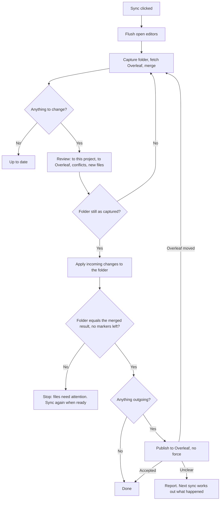

# Scient ↔ Overleaf manual sync: implementation plan (revision 5)

Written October 2, 2026; implementation boundaries refreshed October 11 and 13. Status: **approved by the owner on October 2, 2026, as the working plan; it can still change.** This is the feature's planning owner until it ships; then its lasting facts move into [the engine internals](./scient-overleaf-engine.md) and user documentation, and this file becomes a historical record. D8 was answered yes. The engine and retained local applier have landed (#486). The coordinator (PR B) is specified by the [transition and ownership contract](./scient-overleaf-coordinator-contract.md), which also records the October 13 owner decisions and the status of each PR B step.

**Where to start.** Read section 1, section 4 and section 6 here, then the contract's sections 2–4 and 11. Current progress is the step table in the contract's section 11; the engine's current behavior is in [the engine internals](./scient-overleaf-engine.md).

**Order with live sync (agreed October 4, 2026).** This feature ships first. Live sync (planned separately, not yet published) follows and reuses four things built here, so they are designed for both: the file replacement method (4.6), the connection record with a mode (4.8), pausing for checkpoint restores (4.6), and the review sheet (PR C).

Revision 2 came from my own first-principles review of the first draft. Revisions 3 and 4 folded in two Codex reviews. Revision 5 replaces argument with evidence: the sync rules were written as an executable model and explored exhaustively within stated bounds, and the file replacement was prototyped on the real filesystem. Those review records and prototypes are local working records and are not published; section 2 keeps every finding that changed the plan, the model's cases now run as `WorkspaceApplier.model.test.ts`, and the prototype was superseded by the merged applier. The original assessment used main `feedb89068` and PR #121 head `3bdf7486fc`; those are historical references. The coordinator contract inspects main `988ceaa4d2cdf3311a77d84d6371c029971b52f9` and PR #495 head `45bcd84a741a231734d1d2524921aeb2e56f9e36`, incorporating the [completed Cloud findings](../reports/overleaf-cloud-qualification-20261009.md). Refresh changed source owners before implementation; preserve the settled architecture.

## 1. What gets built

**A manual, two-way manuscript-file sync between one folder in a Scient project and one Overleaf project, over Overleaf's Git integration.** It behaves like a careful `git pull` followed by `git push`: Scient brings Overleaf's changes into the folder first, and then publishes exactly what is in the folder.

Included:

- Connect an Overleaf project to a new or existing folder.
- Sync on demand: one review of what changes on each side, then apply.
- Text conflicts resolved in the Scient editor (by you or the agent), with one-click "keep mine" and "use Overleaf's".
- Safe behaviour after a crash, a lost network response, or edits made during a sync.
- Settings, a Sync control in the LaTeX toolbar, user and internals documentation.

Not included (section 10): live collaboration, automatic sync, generated-artifact ownership rules, one-time ZIP exchange for free Overleaf accounts, agent-triggered sync.

**Who it serves.** On Overleaf Cloud, Git works on a project when either its owner has a paid plan or the person connecting does. Overleaf's own pages describe this inconsistently, so Scient applies no rule of its own: connecting tests real access to that project and reports what Overleaf answered.

**What is claimed as supported at release:** Overleaf Cloud, from the macOS desktop app. Server Pro, custom hosts, Windows and Linux remain unverified; this plan does not establish that their product paths are available. The first coordinator contract admits official Cloud endpoints; additional hosts need their own host policy and qualification.

## 2. What the reviews and the checker changed

### 2.1 My own review (revision 2)

| #   | First draft                                           | Problem                                                                                                          | Now                                                                                         |
| --- | ----------------------------------------------------- | ---------------------------------------------------------------------------------------------------------------- | ------------------------------------------------------------------------------------------- |
| 1   | Publish to Overleaf, then update the folder           | Collaborators receive a merged manuscript that never existed on your disk                                        | Folder first. Publish only a tree verified to be on disk.                                   |
| 2   | Whole-file conflict choices only                      | Choosing a side discards the other side's unrelated edits in a large `.tex` file                                 | "Merge in editor" with standard conflict markers; keep-mine and use-Overleaf's as shortcuts |
| 3   | Twelve-state durable operation that waits on the user | The waiting states are where the PR's defects lived                                                              | A sync plan is an immutable value; conflicts are a condition of the connection              |
| 4   | Confirmation only for risky changes                   | Agents and builds drop files into folders                                                                        | Review always shown; new outgoing files have checkboxes                                     |
| 5   | Dropped revert detection                              | Restoring a checkpoint or switching branch silently produces an outgoing change that removes collaborators' work | Flag outgoing files equal to an older synced version                                        |
| 6   | Real Overleaf test last                               | The riskiest assumptions are about Overleaf's bridge                                                             | Protocol test first                                                                         |
| 7   | Accounts with author fields; four PRs                 | Concepts without a demonstrated need                                                                             | One token per host; three PRs                                                               |

### 2.2 Codex's review (revision 3)

Codex read the first draft, so some of its points were already superseded. Each was re-tested against revision 2.

| Codex's point                                                      | Still applies? | What I found                                                                                                                                                                                                                                                             | Change                                                                                                                                                 |
| ------------------------------------------------------------------ | -------------- | ------------------------------------------------------------------------------------------------------------------------------------------------------------------------------------------------------------------------------------------------------------------------ | ------------------------------------------------------------------------------------------------------------------------------------------------------ |
| Per-file base loses a rename when a file is edited mid-sync        | Yes            | Reproduced under revision 2 as well. I also tested the obvious alternative (leave the base untouched): ordinary `git merge` 2.54 then **silently drops the local edit** with a clean exit. So the per-file rule is the safe one, and the handling around it needed work. | Re-plan instead of partially applying; apply renames as a group (ordering corrected in revision 4); a planner guard against silent drops (section 4.2) |
| Conflicts can span several paths; Git 2.38 output is not parseable | Yes            | Confirmed both. A rename/rename conflict lists three paths. Git 2.38 documents its conflict messages as free-form; 2.39 adds structured records.                                                                                                                         | Conflicts are groups of paths; one uniform resolver; every tree is validated; minimum Git is 2.39 (sections 4.3, 3)                                    |
| File-write guarantees overstated                                   | Yes            | Correct. Agents write files directly, not through Scient's file service, so the shared lock does not cover them. Parent-folder checks have the same instant-after gap as every Scient file write.                                                                        | Guarantees restated; displaced bytes are retained and checked; sync warns when an agent is running (section 4.6)                                       |
| Reconnect should keep a known baseline                             | Yes            | Correct. An empty base turns a collaborator's deletion into "new file to Overleaf".                                                                                                                                                                                      | Relinking keeps the base; tokens are separate from connections; empty base only for new connections or lost history (section 4.8)                      |
| Publication scope and local limits need rules now                  | Partly covered | Revision 2 already made new files opt-in. Reserved paths and local budgets were missing.                                                                                                                                                                                 | Explicit inventory rules and budgets (section 4.9)                                                                                                     |
| Keep accepted-remote and incomplete-apply state durable            | Superseded     | With folder-first there is no "published but not applied" state. The apply-in-progress record stays durable.                                                                                                                                                             | Write order made explicit (section 4.7)                                                                                                                |
| Review the merge and base rules before building on them            | Yes            | Cheap and sensible.                                                                                                                                                                                                                                                      | Codex review added after PR A                                                                                                                          |
| Supported claim should match what was tested                       | Yes            |                                                                                                                                                                                                                                                                          | Section 1 and section 8                                                                                                                                |

### 2.3 Codex's review of revision 3 (revision 4)

All four findings were correct. I reproduced the first two and re-tested the fixes.

| Codex's finding                                                                                              | What I found                                                                                                                                                                                                                                                   | Change                                                                                                                                           |
| ------------------------------------------------------------------------------------------------------------ | -------------------------------------------------------------------------------------------------------------------------------------------------------------------------------------------------------------------------------------------------------------- | ------------------------------------------------------------------------------------------------------------------------------------------------ |
| A crash between deleting a rename's source and creating its destination loses the local edit from the folder | Reproduced. The cause was my own ordering: delete first.                                                                                                                                                                                                       | Create before delete, always. Recovery resumes the recorded apply. A group that cannot be finished becomes a forced conflict (sections 4.2, 4.7) |
| A lost publish response still needs a durable record                                                         | Reproduced the harm: if Overleaf accepted the push and a collaborator then reverted it, the next sync would re-publish over their revert. With a record of what was sent, Scient can prove acceptance from history and treat the revert as an incoming change. | Publish-attempt record with three outcomes (section 4.5)                                                                                         |
| The retained copy does not guarantee detection                                                               | Correct. A writer holding the file open can finish after the check.                                                                                                                                                                                            | Claim narrowed to retention; re-check points and retention period defined (section 4.6)                                                          |
| Eligibility and limits were stated wrongly                                                                   | Confirmed against Overleaf's premium-features page. The 100 MB figure is Overleaf's recommendation, not a limit.                                                                                                                                               | Section 1; budgets are Scient policy and enforced (section 4.9)                                                                                  |
| Commits need a defined author identity                                                                       | Agreed.                                                                                                                                                                                                                                                        | Fixed neutral identity, never the machine's (section 5)                                                                                          |

### 2.4 The checker and the filesystem prototype (revision 5)

The checker found five defects in revision 4's rules that three rounds of reading had missed. Each is a short sequence on one or two files.

| #   | What the checker found                                                                                                                                     | Rule now                                                                                                                                                                 |
| --- | ---------------------------------------------------------------------------------------------------------------------------------------------------------- | ------------------------------------------------------------------------------------------------------------------------------------------------------------------------ |
| 1   | A failed write to a file you had renamed locally still advanced the base for its old name. The next sync then removed a collaborator's edit from Overleaf. | The base advances per **file identity**: a file's paths on both sides, linked by renames, move together (section 4.2).                                                   |
| 2   | A hand-made rename identical to an incoming one was mistaken for the engine's own half-finished work and rolled back, deleting your file.                  | The engine removes or rolls back only a file it has **recorded as written by this apply** and that is still unchanged. Equal content is not proof (section 4.2).         |
| 3   | One conflict decision produced two separate file changes; one succeeded and one failed, and the next sync published the opposite of what you chose.        | Changes that belong to one file identity or one conflict decision are one **unit**: all done, or the unit is interrupted and returns as a forced conflict (section 4.2). |
| 4   | An incoming deletion found the file already gone and counted it as done; you had renamed it, so the next sync sent it back to Overleaf as a new file.      | A file that is already gone was moved or deleted by someone else. The deletion is **not done** and the base stays (section 4.2).                                         |
| 5   | An edit made right after an incoming change was written looked like a failed write and produced a needless conflict.                                       | Each finished step is **recorded as done**; later edits are yours (section 4.7).                                                                                         |

With those rules, seven configurations complete with no violation, between 18,000 and 293,000 states each; the largest (two local actions, two Overleaf actions, a crash, a lost response and a late write together) was stopped at 4.1 million states with none found. This is evidence within small bounds on Git 2.54, not a proof. Its recorded counterexamples and sampled sequences run against the real applier in `apps/server/src/scient/overleaf/WorkspaceApplier.model.test.ts`.

The checker also confirmed that conflict groups must include rename counterparts (without them a collaborator's edit is removed), and that every earlier rule set fails as its reviewer said: revision 3's ordering, the missing publish-attempt record, the untouched base after a partial apply, and check-then-replace. One rule it could not justify: with the planner guard switched off, nothing failed within these bounds. The guard stays as a second line of defence, but it is not carrying the weight I had assumed.

The filesystem prototype changed the replacement mechanism:

| Measured on this Mac (APFS)                                                | Result                                                                                                                                                                                                                     |
| -------------------------------------------------------------------------- | -------------------------------------------------------------------------------------------------------------------------------------------------------------------------------------------------------------------------- |
| Move aside, then exclusive create: races and a crash at each of six points | 31 tests pass. Nothing is overwritten; recovery ends with the old or the new file.                                                                                                                                         |
| How long the path is empty                                                 | Median 0.55 ms, 99th percentile 1.1 ms, worst seen 6.4 ms with the fastest ordering; about 4.4 ms median if the folder is synced inside the gap. Not "an instant", and a crash there leaves the path empty until recovery. |
| A reader polling the path during continuous replacements                   | Saw the file missing in a large share of reads.                                                                                                                                                                            |
| Atomic exchange of two paths (a ten-line native helper)                    | Zero of 7,946 concurrent reads found the file missing; the displaced file is exactly what was there; 1.3 ms per call.                                                                                                      |

So the recommendation changes again: **atomic exchange where the platform has it (macOS, Linux), move-aside as the fallback** (section 4.6). This is decision D8.

## 3. Decisions I have assumed

| #   | Decision                            | Default                                                                                                                                                                                                                                                                  |
| --- | ----------------------------------- | ------------------------------------------------------------------------------------------------------------------------------------------------------------------------------------------------------------------------------------------------------------------------ |
| D1  | Scope                               | Manuscript-file sync only.                                                                                                                                                                                                                                               |
| D2  | Order                               | Folder first, then Overleaf. A workflow choice: a failed publish leaves you with a merged folder and unsent changes. It does not by itself prove the result compiles.                                                                                                    |
| D3  | Conflicts                           | Merge in editor for text; keep-mine and use-Overleaf's shortcuts; multi-file conflicts get those two choices for the whole group.                                                                                                                                        |
| D4  | Review                              | Always shown when a sync would change anything.                                                                                                                                                                                                                          |
| D5  | Git                                 | System Git, version 2.39 or newer, with a clear message otherwise.                                                                                                                                                                                                       |
| D6  | Delivery                            | Reviewable layers from current main. Engine/applier layers have landed; helper/probe #495 precedes PR B or is its explicit stack parent. PR #121 is closed with credit to Yishay Polatov once the replacement is up; I ask before closing it.                            |
| D8  | File replacement (**decided: yes**) | Owned macOS atomic-exchange helper, packaged/signed through #495. Packaged macOS refuses a missing/incompatible required helper; it does not silently use move-aside. Explicit standalone/development fallback has a missing-path window and distinct recovery evidence. |
| D7  | Real-Overleaf test                  | Disposable Cloud protocol gate completed October 9 for the exercised cases; token was entered locally. Actual network loss remains unverified and does not block PR B's deterministic uncertain-outcome contract.                                                        |

## 4. How a sync works



### 4.1 Trees and the merge

The private repository is bare; nothing is ever checked out. Each sync uses four trees:

| Tree   | Meaning                                                   |
| ------ | --------------------------------------------------------- |
| Base   | Per file, a version that both sides have already absorbed |
| Local  | Bytes captured from the folder for this sync              |
| Remote | Overleaf content just fetched                             |
| Merged | `git merge-tree` of Local and Remote over Base            |

The original throwaway-repository experiments used Git 2.54. The delivered engine/applier (#486) and helper increment (#495) subsequently passed focused qualification with Git 2.39.0; their PR descriptions hold the evidence. Those results qualify their recorded revisions, not the future coordinator. PR B exercises its complete service journey at the supported Git floor too.

### 4.2 Base, re-planning and renames

**Re-plan, do not partially apply.** Review takes time, and agents keep working. Before writing anything, Scient checks that every file it is about to change still matches the capture. If not, it writes nothing, captures again, and merges again against the Overleaf state it already fetched. If the new plan differs from what you confirmed, the review is shown again. This lets a file edited during review follow an incoming rename correctly, which I tested.

**Per-file base, for the partial case.** A file can still change between that check and its write. Then:

- A file that now holds the merged content takes Remote's version as its base.
- A file that was skipped keeps its old base.
- After an accepted publish, base becomes the published tree.

"A file" here means a **file identity**: its path locally, its path on Overleaf and its path in the base, linked by any rename on either side. Those paths advance or stay together. Advancing by path alone lost a collaborator's edit in the checker.

**Units.** All changes that touch one file identity, or that come from one conflict decision, form a unit. A unit is done only if every part is. A unit that is partly on disk is recorded as interrupted as a whole.

**Only undo what is provably ours.** The engine removes or takes back a file only if this apply's record says it wrote that file and the content is unchanged. A file that merely equals what the engine intended may be your own work.

**Already gone is not done.** If a file to be removed is already missing, someone else deleted or renamed it. The engine leaves the base alone so the next merge sees their action.

**Structural changes are applied as a group, and content is created before anything is removed.** A rename, a folder move, or a file replaced by a folder is one group. For each group:

1. Check that every source file still matches the capture. If not, skip the whole group and leave its base untouched; the next sync carries the edit into the renamed file.
2. Write the destinations, and record that they were written.
3. Remove the sources, re-checking each. If a source changed or vanished in the meantime, take the destination back (it is provably ours) and skip the group.

When a destination cannot exist until a source is gone (a file becoming a folder of the same name), the source is moved aside under a temporary name first and removed last. At no point during a group are the bytes absent from the folder. Revision 3 deleted first; Codex showed that a crash at that moment loses the local edit from the folder, and I reproduced it.

The base for a group advances only when the whole group is done.

**Why the base must never lag behind a half-applied rename.** With the destination already created, the source still present and edited, and the base not advanced, Git merges cleanly and deletes the edited source. I reproduced this with an ordinary `git merge`. Two defences:

- The apply record is written before the first file write, and recovery (section 4.7) runs before any later sync.
- **Planner guard:** after every merge, any file that changed locally since base and would be deleted by the merge without being the source of a detected rename is turned into a conflict. This check does not depend on Git's judgement.

Publishing happens only when the managed publication domain and approved additions match the reviewed candidate. Local-only files are excluded. Check markers only on durable records of Scient-generated conflict material; ordinary Markdown underline headings are not publication failures. Applier completion alone does not authorize a push: the coordinator independently captures and verifies the candidate, then sends pinned immutable objects.

### 4.3 Conflicts

A conflict is a **group of paths**, taken from Git's structured conflict records and widened to each file's rename counterparts on both sides. Most groups have one path. A rename on both sides has three. Without the widening, choosing a side removed a collaborator's edit in the checker.

- **Text content conflict (one path):** "merge in editor" writes the merged file with markers labelled Scient and Overleaf. Your pre-sync version stays in the sync snapshot. The file is recorded as needing attention, and publishing waits until the markers are gone.
- **Any group:** "keep mine" sets every path in the group to its Local state; "use Overleaf's" sets every path to its Remote state. One rule covers rename/rename, modify/delete, binary files and file-versus-folder, with no per-type logic.
- **Unknown conflict type:** treated as a group with those two choices. Nothing is guessed.

Every tree Scient constructs is validated before use: no path may be both a file and a folder, no case-only collisions, no reserved paths. Codex showed Git's index plumbing silently drops an entry in the first case, so Scient checks this itself.

### 4.4 Review content

- **To this project** and **to Overleaf**: added, changed, renamed, deleted, with text diffs.
- **New files to Overleaf**: checkboxes; unchecked files are remembered as local-only.
- **Restores an older version**: on any outgoing file whose content equals one of the last twenty synced versions of that file. Catches restored checkpoints and branch switches exactly; does not catch a hand-made partial undo.
- **Renames**: flagged, because Overleaf treats a Git rename as delete-and-create and drops that file's comments and tracked changes.
- **No sync history** (section 4.8): stated at the top when the base is empty for a folder that already has files.
- **First sync of a connection**: Overleaf's own advice: pushing through Git can lose or displace comments and tracked changes, and Overleaf does not recommend mixing the two.

The disposable Cloud probe confirmed comment/tracked-suggestion loss for the exercised content-preserving rename. It showed the publisher as **You (via Git)**. Keep the rename warning and do not promise a visible Scient author label. Review acknowledgements bind to an immutable candidate; changes in authority, base, checkout epoch, capture, choices or remote head require a replacement review. The concrete validity rules are in [the contract, section 5](./scient-overleaf-coordinator-contract.md#5-plan-validity-and-publication-boundary).

### 4.5 Publish outcomes

| Outcome        | Evidence                                                                           | What happens                                                                                                                                                                                                                                      |
| -------------- | ---------------------------------------------------------------------------------- | ------------------------------------------------------------------------------------------------------------------------------------------------------------------------------------------------------------------------------------------------- |
| Accepted       | Push acknowledged                                                                  | Base becomes the published tree.                                                                                                                                                                                                                  |
| Overleaf moved | Explicit out-of-date rejection                                                     | Prepare again and show the new review.                                                                                                                                                                                                            |
| Not sent       | Scient refused to start the push because the checkout changed after recording      | Definite: nothing was sent. Preserve the post-apply base; prepare again. A crash before this is recorded leaves the attempt unknown (owner decision 2).                                                                                           |
| Unclear        | Timeout, dropped connection, cancellation after possible send, any other rejection | Keep the attempt unknown and preserve the post-apply base. Classify positive evidence before a new plan; another send requires a fresh explicit review acknowledging unresolved earlier publication. Later disk edits are separate local changes. |

**Publish-attempt record.** Before sending, the connection document durably records the commit and tree being sent, its expected remote parent, review/operation identity and base generation. Pin the objects first. Acceptance/rejection is finalized together with the base/attention transition; a failed finalization leaves the unknown attempt recoverable. If it is still there at the next explicit sync/recovery after a restart, Scient fetches and classifies it:

| What the fetch shows                                                                 | Conclusion                       | Effect                                                                                                                                                                                                                                   |
| ------------------------------------------------------------------------------------ | -------------------------------- | ---------------------------------------------------------------------------------------------------------------------------------------------------------------------------------------------------------------------------------------- |
| Overleaf's head is our commit, or has the same tree                                  | Accepted                         | Base becomes what we sent.                                                                                                                                                                                                               |
| Our commit, or its exact tree, appears in Overleaf's history since the recorded head | Accepted, then changed by others | Base becomes what we sent. Later changes, including a collaborator undoing ours, arrive as incoming changes.                                                                                                                             |
| Neither, or history unavailable/rewritten/bounded out                                | Not established                  | Base stays and the attempt remains unknown. A subsequent explicitly acknowledged reviewed apply/publication may supersede its baseline authority without falsely declaring rejection; late older evidence cannot rewind that later base. |

Without this record, an accepted push followed by a collaborator's revert would be re-published over their revert at the next sync; I reproduced that. The history walk is bounded. Nothing is ever republished without a review.

A local remote cannot reproduce every Overleaf apply/acknowledge failure. The completed Cloud probe discarded a response after a real accepted push, then recognized acceptance through bounded history after a browser restore without publishing again. This qualifies that experiment, not actual TCP loss. PR B must test unknown outcomes and restart boundaries deterministically and keep absent evidence unknown; real network fault injection is separate qualification.

### 4.6 Writing to the folder: what is and is not guaranteed

The implemented retained replace/remove methods are owned by `apps/server/src/scient/workspace/WorkspaceFileMutations.ts` and exposed through `apps/server/src/workspace/WorkspaceFileSystem.ts`. They share canonical-path locks with saves and other participating writes. The intent, including where the old file will be kept, is recorded durably first. The new bytes are written to a complete temporary file. Then:

- **Atomic exchange** (macOS and Linux, through a small native helper): the temporary file and the manuscript file swap places in one step. The path is never empty, and the file that was displaced is exactly the file that was there.
- **Move aside, then exclusive create** (fallback): the current file is renamed into the retained area, and the complete temporary file is published with a hard link that fails if anything is at the path.

In both, the displaced file is compared with the capture. A mismatch initiates bounded restoration and attention handling; under continued interference, the latest bytes may remain in retention rather than at the original path. Do not promise successful put-back in every race. Removal uses the retained path without new bytes.

**The put-back is itself an exchange that reports what it took out.** Checking "our file is still at the path" and then exchanging back are two steps, and a program can replace the path between them. So the put-back exchanges the displaced file back and then looks at what came out of the path. If it is our staged file, untouched, the put-back is done. If it is anything else, a newer file from another program, it is exchanged straight back so the newest content stays at the path, and both other files stay as retained copies listed for the user. After three such rounds the apply stops and reports.

**Recovery decides by file identity, not content.** The apply record holds the staged file's identity (device and inode) before the first exchange. After a crash: the slot holds the staged file means the exchange never happened, or a put-back finished. Either way the change was skipped and the path holds the program's file. The slot holds another file means the exchange happened and the comparison above runs. The content rules of 4.7 then apply as written.

**Shared with live sync.** The two `WorkspaceFileSystem` methods are one primitive for both features: exchange, then return the displaced file's identity, bytes and retained location before anything is released. What to do about a mismatch is the caller's choice. Git sync puts the file back and skips (above). Live sync keeps its write, takes the displaced content as a local edit, and writes again. Retention periods are the caller's too.

| Writer                                                                                                    | With atomic exchange                                                                      | With move-aside                                                                              |
| --------------------------------------------------------------------------------------------------------- | ----------------------------------------------------------------------------------------- | -------------------------------------------------------------------------------------------- |
| Scient editor saves and other file-service writes                                                         | Never overwritten: they share the per-file lock                                           | Same                                                                                         |
| A direct write (agent, external editor) finished before the swap, in place or as a whole-file replacement | Its file is what gets displaced; the mismatch is seen and its file is put back            | Same                                                                                         |
| A direct write that creates the file while the path is empty                                              | Cannot happen                                                                             | The create is refused; their file stays; the original is retained                            |
| A program that holds the old file open and writes later                                                   | Bytes land in the retained copy and are kept. Found at the next re-check, not immediately | Same                                                                                         |
| A reader (LaTeX build, editor reload, agent) during the replacement                                       | Sees the old or the new file                                                              | Can see no file for about a millisecond                                                      |
| A crash mid-replacement                                                                                   | Old or new file is in place                                                               | The path can be empty until recovery runs at restart; recovery never overwrites a newer file |

Retained copies are re-checked at the end of apply and each explicit sync/recovery. A releasable copy is kept for at least seven days and through a later completed sync. Changed, ambiguous and interrupted copies are never released automatically. Copies live under Scient's state directory, on the manuscript's volume and outside the checkout; a checkout on another volume is refused rather than given a vault beside it (owner decision 1). PR B owns compare/restore results, capacity failure and disconnect archives as specified in [contract section 8](./scient-overleaf-coordinator-contract.md#8-retention-disk-failures-and-inventory-budgets). The applier alone does not delete retention. An indefinitely held external handle remains a limitation of finite retention.

Volumes that support neither exchange nor hard links are declined at connect, with a clear message. There is no copy-based fallback: Node's file copy is not atomic, and I have not tested one.

Containment: the target's real path is re-checked immediately before writing. A parent folder swapped for a link after that check is not prevented. Every Scient workspace write has this gap today. It belongs to shared file-service hardening and is tracked separately; the reason to defer is ownership and accepted scope, not that it cannot happen.

Sync reads bounded V2 active-run/turn/background metadata and resolves verified physical checkout bindings for the agent-activity warning. PR B must implement and qualify this aggregation; a changed active-writer set refreshes the acknowledgement. The warning does not lock agent shell writers, and a failed activity read is not “no active agents.”

**Checkpoint restores pause sync.** The current owner is `apps/server/src/orchestration-v2/CheckpointService.ts`, not the old checkpoint reactor. Its private keyed lock does not exclude file saves or an Overleaf apply. PR B adds a shared canonical-checkout barrier to restore, branch/pull and relevant target-worktree mutation paths. Audit the direct startup auto-pull in `serverRuntimeStartup.ts` as well as `GitWorkflowService.ts`; a facade-only hook is insufficient. Bulk mutations close apply admission, wait for application/finalization, and invalidate review epochs. A restore that finds an unfinished Overleaf apply on an idle connection finishes that local recovery itself and refuses only if it fails (owner decision 3). Lock order, safe cancellation and publication after the barrier are defined in [contract section 9](./scient-overleaf-coordinator-contract.md#9-checkout-barrier-and-lock-order).

Synthetic dev-app editor/reload/save/LaTeX replacement acceptance was recorded for #486 in its PR description. This does not qualify a complete Sync workflow. The ordinary file-session registry still lacks a public folder-scoped flush; the document registry's flush operates within one renderer. Flush before prepare and again before confirm, fail on unsaved/unconverted input, and qualify another window's retained draft in PR C. The earlier check-then-replace approach is not an acceptable fallback.

### 4.7 Durable state

One document per connection, durably replaced, plus pinned immutable intents and references in the private repository. PR B's contract specifies command receipts, compare-and-set generations, single-owner admission and a feature-specific process lease; the current applier semaphore is not a cross-process lease.

- Identity: workspace binding, real folder path, Overleaf host and project, branch.
- Base tree, the last twenty bases, the last ten local snapshots as recovery points.
- Local-only paths and files needing attention.
- An apply-in-progress record: the plan's trees, the units, which destinations this apply wrote, which steps are done, and where each displaced file is kept.
- A publish-attempt record (section 4.5).

Write order: pin immutable objects and reference the apply intent in the connection, then let the applier sync its `plan.json` and progress record before files, then atomically adopt its base/attention result and clear the active link when safe. Git refs and connection JSON are not one transaction; orphan artifacts are harmless, missing referenced intents are blocking failures.

**Recovery** precedes new work on the connection. Startup exposes pending recovery without fresh Cloud traffic. Under verified current identity and admission, resume the same recorded apply ID with the current host helper; consult durable per-file journals, staged/displaced identities and progress. Content equality alone is never proof of ownership. If the applier completed before connection finalization, reconcile/adopt its result once.

If a syscall preceded the outer done-mark, primitive journal evidence can still establish ownership. Where evidence remains ambiguous, recovery preserves bytes, reports attention and deletes nothing on a guess. Do not treat an uncertain installation as safe to repeat over a later save or deletion.

A unit that cannot be finished, because one of its files changed in the meantime, stays recorded as **interrupted**. Its base does not advance, the captured and intended versions of its files are kept, and in the next review its paths appear as one forced conflict with the usual two choices. Ordinary merging never interprets a half-moved group as your edits.

Unreadable/inconsistent connection, base or intent state blocks automatic recovery. Preserve the originals. Explicit relink/history-reset review may establish an empty base only after local intent/staging is settled, while retaining unknown publication and retained evidence. Neither relink nor token renewal silently resets valid history.

One sync runs per connection at a time. Every change to the connection document is a compare-and-set on its revision, and the store refuses any change that would drop unresolved evidence or rewind the base. A second server process sharing the state directory is refused writes by a process lease.

### 4.8 Connections, relinking and tokens

- **New connection:** project URL, token if none is saved for that host, folder, then a first sync against an empty base.
- **Relink:** the same Overleaf project and a surviving base (folder moved, binding changed, checkout re-registered). The base is kept, so a collaborator's deletion still reads as a deletion.
- **Token renewal:** tokens are stored per host, apart from connections. Replacing one touches no connection state.
- **Lost history:** if the private repository is damaged or missing, report unavailable history and preserve evidence. An explicit reviewed reset can establish an empty base after pending local recovery is settled. Files present on one side then appear as additions, not inferred deletions.
- A connection belongs to one checkout. In a thread's separate worktree the toolbar says Overleaf is connected in the main checkout and does not offer Sync.
- Before fetching, writing and publishing, Scient re-resolves the workspace binding and the folder's real path.
- **One mode per folder.** The connection record has a `mode` field, `manual` for this feature; live sync adds `live`. A folder is owned by one mode at a time, and overlapping or nested connections are refused. Switching modes is live sync's work (its section 8.5); this feature only stores the field and refuses a second connection on the same folder.

### 4.9 What is in the connection, and local limits

**Inventory.** The connection contains the files in its base plus new files you approve in the review. There is no `.gitignore` evaluation.

- Never included or listed: `.git`, `.scient`, any folder that is itself a Git repository, operating-system and editor droppings (`.DS_Store`, `Thumbs.db`, swap files), symlinks, Git LFS pointers.
- Listed but unchecked by default: LaTeX build leftovers (`.aux`, `.log`, `.synctex.gz`, `.fls`, `.fdb_latexmk`, `.out`, `.toc`, `.bbl`) and anything inside a hidden folder.
- A file that has been synced stays in the connection until it is deleted or moved out of the folder. "Stop syncing but keep on Overleaf" is not offered in this delivery.

**Budgets enforced locally, before anything is hashed or sent:**

| Limit                   | Value                                                                                                  | When exceeded                                                                                                   |
| ----------------------- | ------------------------------------------------------------------------------------------------------ | --------------------------------------------------------------------------------------------------------------- |
| New-file listing        | 5,000 entries walked                                                                                   | Listing stops; the review says so and asks you to choose a narrower folder                                      |
| New files               | Listed by name/size, with a bounded prefix read for forbidden formats; fully hashed only once selected |                                                                                                                 |
| Single file             | Existing engine cap 50 MiB; proposed Cloud preflight 50,000,000 bytes                                  | Conservative interpretation of the published 50 MB label, not qualification of the vendor's exact byte boundary |
| Files in the connection | 2,000 (Overleaf's limit)                                                                               | Further new files cannot be checked                                                                             |
| Connection total        | 250 MiB (Scient's implemented cap)                                                                     | Further new files cannot be checked                                                                             |
| Connection total        | 100 MB (Overleaf's recommendation for Git)                                                             | Warning only                                                                                                    |
| Editable text           | 2 MB per file, 7 MB in total (Overleaf's editor limits)                                                | Warning only: Overleaf stores larger files as uploads that cannot be edited there                               |
| Text diff preview       | 1 MB per file                                                                                          | Shown as changed, no preview                                                                                    |
| Git commands            | Per-command timeout and output cap (ported)                                                            | Sync fails with the reason                                                                                      |

Overleaf's figures come from its [plan-limits page](https://docs.overleaf.com/getting-started/free-and-premium-plans/plan-limits), rechecked October 11. The managed byte/listing caps are Scient policy; they do not bound Git history/pack storage or unresolved retention. PR B adds fetched-tree validation, private-repository admission/disk-growth controls and retention capacity handling. Cancellation after apply or possible push reports durable effects and uncertainty; it never claims that nothing happened merely because the request was cancelled.

## 5. Components

Server, `apps/server/src/scient/overleaf/`:

| Module                    | Responsibility                                                                                                                                                                                                            |
| ------------------------- | ------------------------------------------------------------------------------------------------------------------------------------------------------------------------------------------------------------------------- |
| `OverleafGitExecutor`     | Implemented closed environment, operation-scoped askpass, process cleanup, Git version check and test-only local-protocol switch. Commits carry a fixed code-owned identity; Cloud History was observed as You (via Git). |
| `OverleafRepository`      | Bare repository: fetch, write trees from bytes, merge, compare, read blobs, commit, push.                                                                                                                                 |
| `ManuscriptInventory`     | Section 4.9.                                                                                                                                                                                                              |
| `SyncPlanner`             | Pure: trees in, plan out (both lists, conflict groups, warnings, the planner guard, tree validation).                                                                                                                     |
| `WorkspaceApplier`        | Implemented retained grouped apply/recovery through the existing file service. Returns base, interruption, markers, retention, staging and target match; grants no publication authority.                                 |
| `OverleafConnectionState` | Implemented (PR B step 1): connection document, publication attempt and request receipt schemas; the evidence-preservation rules every transition must keep; the private refs recovery needs.                             |
| `OverleafStateStore`      | Implemented (PR B step 1): durable compare-and-set connection store, request receipts, quarantine, process lease, same-volume retention preflight. Host tokens are separate in the server secret store.                   |
| `OverleafSync`            | Prepare, apply, publish, recover, relink.                                                                                                                                                                                 |
| `http.ts`                 | Routes with scope, binding and ownership checks.                                                                                                                                                                          |

Plus one contract file, one client file, and web code under `apps/web/src/scient/overleaf/`.

## 6. Delivery

Delivery follows owner decision 4: PR B ships as stacked PRs, one per contract step (section 11 there holds their status). Steps that apply files (3 onwards) need #495 merged or an explicit stack on its head.

**Step 0: exercised Cloud gate completed.** The disposable probe verified accepted commit/tree identity, explicit stale rejection without mutation, file/folder rename, metadata loss and acceptance evidence after a simulated discarded acknowledgement and browser restore. [Results](../reports/overleaf-cloud-qualification-20261009.md). Actual network loss and size-boundary experiments were not performed; current documented limits are inputs to preflight, not experimentally qualified guarantees.

**Already done: the checker and the filesystem prototype** (section 2.4). The checker's cases run in the product's applier tests; the prototype is superseded by the applier.

**Engine/applier layers delivered.** Executor, repository, pure rules and retained applier are merged, including #486, with review/model/real-filesystem evidence at their recorded revisions. The complete connection inventory is PR B work. Packaged helper/probe plumbing is #495. Do not transfer earlier test results to changed code automatically.

**PR B: sync and routes.** Implement against the [transition and ownership contract](./scient-overleaf-coordinator-contract.md): connection persistence/admission, bounded capture/review, checkout barrier, apply/recover/adopt, verified publication/uncertainty, retained compare/restore, authenticated routes and mount. Its acceptance matrix fixes competing requests, stale reviews, crash boundaries, lost response/edit/revert/restart, token/relink, disk/storage, direct startup pull and updated-helper cases before coding. **A Codex review after each step.**

**PR C: client and UI.** Typed client, Project Settings section (an "Overleaf" section that shows the connection's mode), review sheet (built as a component live sync can reuse for its held-document review), attention state, toolbar Sync with the editor flush, user guide, internals document. Component tests and a visual pass in the dev app. **Third Codex review.**

Rough size: about 7,000 lines including tests and the checker, against the PR's 12,300. An estimate only; recovery tests are not trimmed to meet it.

## 7. The PR's confirmed defects

Removing the old modules removes the old failure paths. It does not by itself show the new code is correct; these tests do that.

| Finding                                                       | Design intent                                                                                                                                       | Test that must pass                                                              |
| ------------------------------------------------------------- | --------------------------------------------------------------------------------------------------------------------------------------------------- | -------------------------------------------------------------------------------- |
| 1. Later save overwritten                                     | Check and write inside the shared lock; retained copy for direct writers                                                                            | Editor save and direct write, before and during replacement                      |
| 2. Swapped parent redirects a write                           | Real path re-checked immediately before writing                                                                                                     | Link-swap before the check; the instant-after gap is documented, not tested away |
| 3. Rejected request clears another's ownership                | Non-queuing per-connection ownership; compare-and-set on the connection revision; durable request receipts; a process lease against a second server | Concurrent syncs                                                                 |
| 4. Restart replays an older commit                            | Recovery resumes only the recorded, confirmed plan; it never applies a fetched head                                                                 | Restart at each step of an apply and of a publish                                |
| 5. Setup mode misroutes conflicts                             | No setup modes, no rebase state                                                                                                                     | Connect with conflicts, then sync with conflicts                                 |
| Toolbar key, stale status, old auth helpers, sync before save | Current selectors, one shared status, current request executor, editor flush                                                                        | Component and client tests                                                       |

## 8. Qualification

| Gate                                                             | Needs                                 | When                                                                                       |
| ---------------------------------------------------------------- | ------------------------------------- | ------------------------------------------------------------------------------------------ |
| Exercised protocol test on Overleaf Cloud                        | Completed disposable-project evidence | Done for recorded cases; actual TCP loss and size boundaries remain unverified             |
| Engine/applier/helper focused tests on Git 2.39                  | Recorded 2.39.0 qualification         | Done at recorded heads; repeat affected evidence after changes and for PR B's service      |
| Editor replacement: unsaved buffer, reload, save, LaTeX build    | Recorded synthetic dev-app evidence   | Foundation accepted; full Sync/two-window workflow remains PR C                            |
| Exchange helper in a packaged, signed build                      | #495 arm64 app/helper evidence        | Packaging gate exercised; #495 delivery/alignment and integrated product acceptance remain |
| Full journey on Overleaf Cloud from the dev app                  | Your project and token                | Before PR C merges                                                                         |
| Packaged macOS build: Git discovery, token passing, cancellation | Local packaged build                  | With PR C                                                                                  |
| Overleaf Server Pro, Windows, Linux                              | Those environments                    | Not planned; labelled unverified in the product                                            |

## 9. Risks

- **What the checker does not cover.** It explores sequences within stated small bounds, not arbitrary projects, writers or Git behavior. Later real applier regressions cover structural folder/file transitions at their recorded revisions; PR B must test the entire coordinator's corresponding recovery path too.
- **Late writers.** A program holding a file open can write after the replacement. Its bytes are kept and reported at the next re-check, not at once.
- **Parent-folder swap** during a write (section 4.6), tracked as shared file-service hardening.
- **Markers in a working file** break the local LaTeX build until resolved.
- **Git merge surprises.** The dropped-edit case shows Git's clean result cannot be trusted blindly. The planner guard and the generated-sequence test exist for that.
- **Shared files and current source owners.** Refresh current main/active branch changes before implementation. October 2's #353/#415 list is historical; use the pinned owner table in PR B's contract and check subsequent changes.
- **Overleaf's bridge.** The completed probe closes its exercised cases only; unavailable/rewritten history and real network faults remain uncertain.
- **Folder renames.** The exercised Git rename lost review metadata and left an empty original folder visible. Arbitrary rename/create combinations remain unqualified. Flag renames; never automatically split/retry a rejected publication.

## 10. Follow-ups

1. One-time ZIP import and "Open in Overleaf" export, which also serve free Overleaf accounts.
2. Generated-artifact publishing with per-file ownership.
3. Shared file-service hardening for the parent-folder gap; an equivalent of atomic exchange on Windows.
4. "Stop syncing this file", "skip review for edits-only syncs", and a read-only "Overleaf has changes" indicator.
5. A read-only sync status tool for agents.

## 11. Review step

After each of the three PRs, read-only, with the model you named:

```sh
codex exec -m gpt-6.1-sol -c model_reasoning_effort=high -s read-only -C <worktree> "<review brief>"
```

`gpt-6.1-sol` is the model ID in your Codex configuration. The brief gives Codex the diff range and this plan, and asks for defects without telling it what I expect. I report its findings as written, then fix what holds up.
