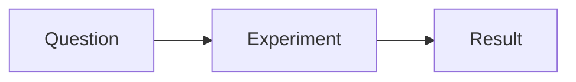

# Writing Markdown

Status: Draft
Owner: Yaacov
Created: 2026-10-22
Last updated: 2026-11-10
Purpose: Help for rich and Source Markdown editing, scientific objects, saving, and recovery.
Doc type: Current implementation

Scient lets you edit a project's Markdown as a rendered document or as exact
source. Both presentations save to the same `.md` or `.markdown` file. The rich
editor supports prose and scientific objects while retaining source it cannot
represent as rich content.

## Open or create a document

Open a file from **Files** or a link in chat. To start a document, choose
**Markdown** from one of these menus:

- The side panel's **Documents** menu, or the Markdown format button on the
  **Document** card in a new **+** tab, creates it at the project root.
- The Files bar's **New document** button (file-plus icon) opens a menu using the selected folder, or the folder
  of the selected file. With no selection it uses the project root.
- A folder's context menu offers **New document here → Markdown**.

These routes create an available `untitled.md` with an empty first-level heading.
Write that heading as the title. The hint beside it shows the proposed filename.
After the title is saved and you leave it, Scient attempts a one-time rename,
using a numbered name if needed. Later heading edits do not keep renaming the
file. Use the file header's rename action when you want another name or path.
Creation and naming can stop at a file or permission problem; existing files
are not overwritten.

Click the rendered document to place a caret and type. Expand its formatting
tools when you need them; they also open after an accepted edit. Collapsing the
tools does not make the document read-only.

The file-header button switches between **Show markdown source** and **Show
rendered markdown**. Scient remembers that presentation preference. A link to a
specific source line opens Source so the line can be revealed. There is no
Markdown split view. Switching presentation waits for pending changes and does
not itself edit the file.

Outside-workspace files, managed read-only files, read-only connections, and
partial large-file previews cannot use the writable rich surface. MDX has a
separate preview/source path and does not have the same rich-editing contract.
See [File previews](./file-previews.md) for file opening, refresh, rename, and
other file-header actions.

## Write and navigate

The formatting row adapts to the panel width. Some controls move into
**Document** when space is limited. The selection toolbar also offers common
inline formatting and link actions.

| Control      | What you can do                                                                                                             |
| ------------ | --------------------------------------------------------------------------------------------------------------------------- |
| **Text**     | Choose Paragraph, Heading 1–6, or Quote; apply bold, italic, inline code, or strikethrough; clear formatting; set direction |
| List menu    | Choose Bullet list, Numbered list, Task list, or No list                                                                    |
| **Insert**   | Add an image, table, code block, reference, divider line, or line break                                                     |
| **Math**     | Insert inline/display math or open Symbols & structures                                                                     |
| **Document** | Open the outline or Find & Replace; move, duplicate, or delete blocks; export; open Keyboard shortcuts                      |

Type `/` at the start of a paragraph to open the block menu. Continue typing to
filter it, use the arrow keys to choose an item, and press **Enter** to insert.
The slash menu includes text, headings 1–3, lists, quote, code, equation, footnote,
table, image, wiki link, and divider. It offers a subset of the menus.

At the start of a paragraph, Markdown prefixes such as `# `, `> `, `- `, and
`1. ` create headings, quotes, or lists as you type. Use the formatting menus or
Source for syntax that has no typing shortcut.

**Document → Document outline** lists the rich headings and moves to the chosen
heading. **Move block up**, **Move block down**, **Duplicate block**, and **Delete
block** act on the selected top-level block or blocks. A list, quote, or table is
one such block. Leading front matter cannot be moved or duplicated. Commands
unavailable at the current selection are disabled.

The footer shows the caret's context and word count, including the selected-word
count. This is a count of the rich document's text, not every hidden source field.
Table controls appear there while the caret is in a table. Opening menus,
selecting objects, moving the caret, and using viewing controls do not themselves
save changes.

### Find and replace

Use **Document → Find & Replace**, or Command/Ctrl+F while the Markdown editor
has focus. Enter a query, optionally enable **Match case** or **Match whole
word**, and use the previous/next buttons. **Enter** moves forward and
**Shift-Enter** moves backward while the find field is focused. Expand **Show
replace** to replace the current match or all matches. **Escape** closes the bar.

Rendered search includes prose and table-cell text. It skips code blocks and
source stored inside objects, including TeX, citation fields, image details,
footnote bodies, and raw source boxes. Opening Find from a nested field still
searches the rich document. Switch to Source to search the exact Markdown.
Conversation search and project-wide search are separate commands.

## Links and wiki links

Select text and use **Insert → References → Link**, the selection toolbar, or
Command/Ctrl+K. Enter a URL or relative path and choose **Apply**. **Cancel**
leaves the document alone; **Remove** removes the link while keeping its text.
Right-click a link on desktop for editing and copy actions. **Copy link** keeps
the authored destination; **Copy full path** is available for resolvable
workspace destinations.

An ordinary click follows a link after Scient determines that you are not
dragging or double-clicking. Drag to select its text; Command/Ctrl-click follows
immediately. Same-document heading links navigate within the rich document.
External web/mail links use the app's external-opening path.

Workspace links resolve relative to the document. If a file has moved, Scient
can consult the workspace file resolver; an ambiguous result can open the file
panel's choices. An unavailable target or missing same-document heading leaves
the current document open with feedback. Following a link does not create a
missing file. Links outside the workspace can open a read-only file preview.

To choose a real project Markdown target, select prose and use the wiki button
in the selection toolbar. Its picker searches filenames and paths and shows
recent choices. Select or double-click an existing wiki link to edit its target.
**Insert → References → Wiki link ([[note]])** and the slash wiki command instead
insert an `[[Untitled]]` placeholder; edit that link before following it. Source
supports `[[note]]` and `[[note|label]]`. A wiki link does not create its target.

## Lists and tables

Use the list menu to convert prose to a bulleted, numbered, or task list. Task
checkboxes can be toggled in the rich document. **Enter** continues a list;
**Tab** nests an item and **Shift-Tab** lifts it where the current structure
allows. Empty-item Enter follows the list context.

Choose **Insert → Table** and select its rows and columns in the size grid.
The picker starts at 8 by 8 and can grow to 15 by 15; the slash-table command
inserts a 3-by-3 table. The first row is the header. In a cell:

- **Enter** or **Shift-Enter** inserts a line break in that cell.
- **Tab** and **Shift-Tab** move between available cells. Use the table actions
  to add a row or column.
- The footer adds rows/columns and aligns columns. **More table actions** also
  selects the whole table, inserts above/before, clears alignment, or deletes a
  row, column, or table.
- On desktop, right-click a cell or the table's corner handle for the table
  menu. A link inside the cell keeps its link menu.

GFM tables have one header row and inline cell content. Headings, nested lists,
and block objects cannot be inserted inside cells. Merge/split and header-cell
toggle controls are disabled; arbitrary column widths are not a rich Markdown
feature. Column alignment is physical left/center/right. Table direction changes
column order; each cell still derives text flow from its own text.

Structural edits can change how adjacent blocks parse after reopening. In
particular, duplicated neighboring bullet or numbered lists can become one
list. Check Source and the reopened result when a boundary between lists matters.

## Footnotes, citations, and shared references

**Insert → References → Footnote** and `/footnote` create a reference and its
definition together, then focus the definition body. The body is an editable
source-text field, rather than a second rich document. Click a numbered marker
to reach its definition, and **Back to text** to return. Repeated references to
the same label share one definition and number. Numbers follow first-reference
order; the labels in Source remain the bindings.

On desktop, a footnote marker's context menu offers navigation, copying its
internal link, and removing that reference. It can remove the definition along
with the last reference. A missing definition is shown as unresolved rather
than silently generating content.

Source can contain citation syntax such as `[@smith2024]` or
`[@smith2024; @jones2025]`. The rich document exposes a citation-source field
that preserves the keys and surrounding citation text. The rich editor does not
resolve keys, generate a bibliography, or connect automatically to the
[Library](./sources.md). There is no Markdown citation-picker command.
These fields are distinct from LaTeX citation tools and from quoting selected
text into chat.

Link/reference definitions may appear as compact source disclosures while
authoring. Expand one to edit the exact definition. Reference-style links and
images continue to use the shared definition until explicitly made independent;
changing one definition can affect several occurrences.

## Math, code, and scientific visuals

### Equations

Use **Math → Inline math** or **Display math**, or `/equation` for a display
equation. Select existing math to edit its TeX and open **Symbols & structures**
for the shared input tools. Source recognizes supported dollar and backslash
forms, including `$…$`, `$$…$$`, `\(…\)`, and `\[…\]`. Recognition is contextual;
ordinary currency-like text is not always treated as math.

Invalid intermediate TeX can leave the last valid typeset equation visible
while you finish editing. The equation's source field is the text being edited;
the retained render does not mean that input is valid. Markdown math uses the
supported renderer syntax rather than compiling an entire LaTeX project. See
[Math in chat and Markdown](./math-in-chat.md) for syntax and tools.

### Code and source boxes

Code blocks have an embedded source editor. Their headers offer **Copy code**
and **Wrap lines**; copying omits the Markdown fences. Wrapping starts from
**Settings → Word wrap**, and a block's own control changes only that block.
Use Source to change the fence language or other exact fence syntax.

Literal HTML, YAML/TOML front matter, and unsupported or ambiguous constructs
can appear as labeled source boxes. Some mixed constructs, including lists or
quotes containing source-only syntax, become one source box so content is not
silently dropped. Editing a box changes its source; literal HTML there does not
execute as a webpage. If an embedded editor fails to load, use its local retry
action where offered, or switch to the file's Source presentation.

### Diagrams and charts

Use a fenced block with `mermaid`, `vega-lite`, or `plotly` as its language.
Scient displays the specification as an interactive diagram or chart. For
example:

````md

````

Ordinary pointer, wheel, drag, and chart gestures keep their viewing meaning.
Choose the card's **More → Edit source** action to edit the specification. An
invalid intermediate specification can retain the last valid visual while
showing the source problem. Expanding, copying/downloading, resetting a view,
and changing viewing controls do not edit the Markdown.

The interactive renderer recognizes additional aliases, but use the lowercase
names above for portable files. Word's Mermaid capture currently requires the
exact lowercase `mermaid` fence. Interactive rendering in the editor does not
guarantee an equivalent interactive or static object in every export.

## Images and captions

Choose **Insert → Image**, paste an image file, or drop one into the document.
PNG, JPEG, GIF, WebP, and AVIF uploads are supported, up to the 20 MB asset limit;
SVG upload is not supported. The server validates the bytes and type, saves the
asset in a sibling `assets` directory by default, and then inserts a relative
path. Relative image paths resolve from the Markdown file's folder.

Before inserting beside front matter, display math, or another source-only
object, put the caret in an ordinary paragraph and check Source afterward.
The current insertion path can replace a neighboring selectable object in some
boundary cases; upload success alone does not establish a safe insertion.

Select an independent standalone image to edit its caption, or use **More → Add caption** /
**Edit caption**. Captions use the optional Markdown image title. Caption typing
is an edit; selecting the image or leaving an untouched empty caption is not.
Inline, linked, and table images retain compact layouts; caption editing can
isolate an eligible unlinked image from surrounding prose.

**More → Edit details** opens image-source and alt-text fields with **Apply**
and **Cancel**. A non-standalone image also has a title field. There are no rich
image-width or height controls. For a reference-style image, alt text belongs
to that occurrence, while source and title belong to the shared definition.
Choose **Edit shared reference** to change that definition, or **Make independent**
to change only this image.

**Replace image** keeps the existing image until upload succeeds; a changed or
removed target can cancel the replacement. **Remove from document** removes the
occurrence, not the asset file or shared definition. Viewing actions include
Expand, Copy image, Download original, and Copy image source where available.
Workspace images also offer path-copy and open-file actions. Load retries and
viewing-background changes do not alter source.

## Quote selected text into chat

Select prose and choose **Ask in chat** to put a quotation in the composer.
Use a shorter passage if a large selection cannot be quoted.
Rendered project Markdown captures selected text and its source context; Source
captures the exact selected Markdown. A visible embedded code selection can
also be quoted. Whole non-text objects and a chart's hidden specification are
not substitutes for selected text.

In the original workspace, reopening a Source quotation returns to Source. If
the conversation has moved to another workspace, Scient opens the original file
read-only when available and explains the change; the saved quotation is unchanged.
Static read-only text in Files
also supports source quotations; rendered read-only Markdown does not offer the
rich selection action. A quotation is stored with the message, not as a document
annotation. Quoting does not edit or save the file. Navigation back to an edited
document may be unable to highlight an ambiguous or changed passage.

## Saving, refused edits, and recovery

Scient autosaves accepted edits to the project file. Routine saving is quiet.
If a save fails, your text stays editable and Scient keeps retrying. Brief
failures can resolve without a notice; a lasting failure shows **Couldn’t save**,
the available reason and **Save a copy**. That action downloads the accepted
source text as a separate file. It does not repair the original destination or
include refused rich input. Check the copied file before relying on it.
**Details → Copy details** copies available failure information.

A missing current file instead offers **Save it again**. A refresh failure can
show **Try again** to reread the file; this is different from automatic save
retrying. Visible typing is not proof that the disk file was saved. File/view
changes, renames and exports can wait for pending input or saves to settle.

Quitting the desktop app does not wait for the same document-saving checks.
Finish any save or recovery notice and preserve unresolved work before quitting;
the newest typing and unfinished rich input may not yet have a durable copy.

### When an edit cannot be saved as Markdown

A rich edit that cannot be represented safely stays visible, with a notice asking
you to correct it or **Undo**. The accepted source remains unchanged. **Copy
recovery data** copies the retained editor document as JSON; it is not a normal
Markdown export. This unfinished input is held only in the current app session
and is **not protected against restart**. Correct or undo it, or preserve that
recovery data elsewhere before restarting. Another view of the same file can
become read-only until the owning view resolves the input.

### Outside edits and recovery choices

A clean editor can refresh when an agent or another editor changes the file.
When both writers changed unambiguously separate Markdown blocks, Scient can
merge them. A paragraph, list, table or fence is one block; separate lines inside
it do not necessarily merge.

Very large documents (about 256,000 characters or 2,000 blocks) are not merged
automatically. The same local-version/history choice below applies when a
live conflict cannot be merged within those limits.

When a live edit cannot merge, Scient saves your version and keeps the replaced
file in history. A line offers **Use the other version** if you want that text
instead. Overleaf sync has its own conflict workflow and does not silently choose a side.

A recovered draft from an earlier session is different. If the file has changed,
Scient offers **Keep my draft** or **Use the file** before publishing that draft.
Continuing to type counts as keeping it. If you choose the file, **Restore** can
offer the displaced draft while the session retains it; this is not permanent
revision history.

If math, citation or footnote source is focused during an outside change, leave
and recheck the field against Source before typing further: a focused native
field can retain older text. Multiple windows are not a collaborative editor;
checkpoint ownership and simultaneous edits have separate limits. If the notice
says **Another editor owns this file's recovery checkpoint**, preserve this
window's work with **Save a copy**. Continued typing and retries do not restore
that writer's ownership. Do not clear recovery storage to resolve it before
preserving the work from each window.

### File history, recovery copies and undo

The file header's **Retained file versions** menu lets you review earlier file
content and save a separate copy. Ordinary saves keep the bytes they replace in
server-side file history. Scient's own autosaves are sampled five minutes apart;
text written by another program is kept before Scient replaces it. A rename
takes history along and a delete keeps a copy. This is not a history of every
keystroke. Some versions retained by older publication paths can still be
changed by outside file handles; inspect the version before relying on it.

Markdown also keeps an accepted-source draft checkpoint in local app/browser
storage. Reopening checks it against the file, with the choices above when they
differ. This checkpoint is separate from server history, refused rich input,
and a successful file save. The newest typing can be lost before it commits.
Storage has shared record and size limits; failed checkpoint admission can keep
a save retrying without reaching the disk even while typing remains possible.
With several source copies in one record, the budget can be reached around half
a million characters; the exact threshold depends on those copies. Such local
storage/admission failures show **Couldn’t save** immediately while retries
continue, rather than waiting through the quiet retries for a brief disk failure.
Use **Save a copy** and preserve unresolved work before clearing storage or
restarting to investigate a storage problem.

Undo belongs to the active editing surface. Rich commands, embedded code and
equation undo/redo feed rich history; caption fields also retain native text
undo. A save acknowledgement does not clear rich history. Reopening, switching
between rich and Source, or adopting outside content does not guarantee one
continuous undo stack. Untouched source ranges are reused, but editing a rich
block can normalize that block's Markdown. Use Source when exact syntax is the
purpose of the edit.

## Direction, spelling, and shortcuts

Choose **Text → Direction → Auto**, **LTR**, or **RTL** for the current block.
In a table the control is **Table direction**. Explicit direction uses a Markdown
HTML wrapper; Auto removes the explicit wrapper and derives direction from the
text. Code, math, and other technical source remain distinct from prose direction.
See [Content direction](./content-direction.md) for mixed-language writing.

Enter on a selected equation, citation, footnote definition, or source object
can move focus into its field. Escape moves out of a nested editor or closes
the active popover. Inline math/citation fields also use their physical arrow
boundaries to return to surrounding prose. Native selection, IME composition,
and operating-system shortcuts depend on which field has focus. Shortcuts in a
code or source field do not automatically format surrounding prose.

Use **Document → Keyboard shortcuts** for the writing shortcut list, and
[Keyboard shortcuts](./keybindings.md) for settings and context rules. Common
defaults in prose include Command/Ctrl+B for bold, I for italic, E for inline
code, and Shift-Enter for a line break. Use Shift-Command/Ctrl+V when you want
plain-text paste; paste into Source when you need literal Markdown syntax rather
than rich-text interpretation.

Ordinary editable prose uses the host's spelling suggestions. On desktop,
right-click a marked word for available corrections. macOS identifies languages
automatically; Windows/Linux choose available dictionaries using system languages
and sampled text. A dictionary may download on first use. Technical fields can
disable spellchecking, and browser spelling depends on the browser. This is
spelling assistance, not a grammar or scientific-correctness check.

## Export the saved document

Choose **Document → Export → PDF** or **Word**, or use the file-header download
menu for Markdown, PDF, or Word. Export settles and saves accepted edits first.
An unresolved refused edit or save problem must be addressed before an export
can represent the latest work.

PDF needs the desktop app and a connected project environment. Word needs Pandoc
on the environment that owns the files and offers installation when appropriate.
See [File previews](./file-previews.md) for the save
dialog, platform restrictions, and image limits.

Rich editing, read-only preview, PDF, and Word use different Markdown parsers.
Check the output, especially front matter, raw HTML, citations, scientific
fences, and images near math. Front matter is source metadata in the rich editor
and PDF path, but ordinary read-only preview does not use the same front-matter
grammar. Keep scientific fence names lowercase for export compatibility. Shared
visual controls do not guarantee identical interpretation in every output.
