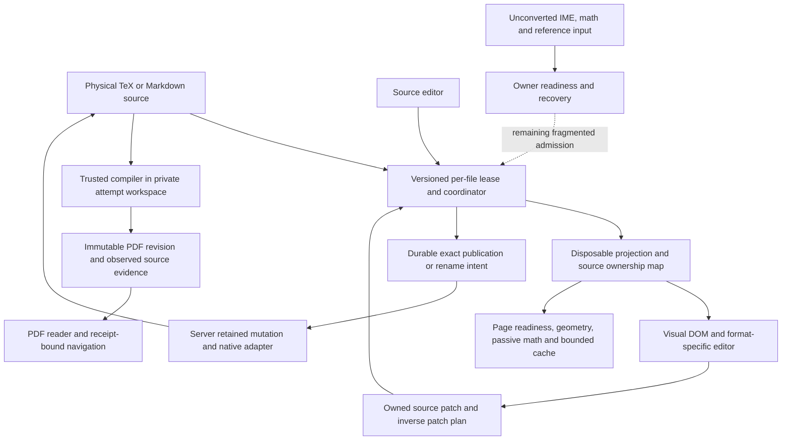

# PR #353 — current document architecture review and remaining shipping plan

**Updated 13 October 2026. Keep the source-first architecture. Much of the original repair plan is implemented; remaining recovery/rename ownership, cross-platform publication and final qualification still prevent a general shipping-ready verdict.**

This supersedes the 11 October diagnosis as the current decision document. All 84 original finding IDs remain below, with revised dispositions against current code. The unaltered original report (local evidence retained separately) preserves the detailed reproductions, historical priorities, 27 comparative claims and earlier work-package proposals. Its failing scenarios and timings belong to its original revision; they are not fresh failures on today's head.

**Publication note (13 October):** this catalogue remains pinned to `b87625d49d`. The linked [current recommendations](CURRENT_RECOMMENDATIONS.md) account for the newer PR head `5f6342e468`; the [comparison receipt](current-plan-pin.json) checks thirteen unchanged modules. Source links below point to the catalogue revision. Historical raw receipts and the original archive remain local; this publication does not rerun their tests.

## 1. What was compared and what this update proves

| Input | Revision and role |
|---|---|
| Original review | `47057d4614cc6890c0393fb4f18c356035094bbb`, original base `c414ac935b49fccb026b5a6e01f4714246375d73`. Historical reproduction/evidence only. |
| Reviewed hosted snapshot of [PR #353](https://github.com/ScientFactory/scient-desktop/pull/353) | `b87625d49d535d9afd3a3319d5e1f1258d7b23db`, OPEN and DRAFT at the final refresh. The PR advanced from `1fb52333c0` during this review. Includes collaborator selection/navigation/layout work, native source-edit repairs, opening/page/cache work and delivered compiler/save/PDF changes. |
| Latest local delivery checkout inspected | `b87625d49d535d9afd3a3319d5e1f1258d7b23db`, clean; `local reviewed delivery checkout`. It additionally merges current main `84a7e2663b30663da371555085cf7316086c041f`. |
| New main merge versus prior hosted head | 44 changed paths from `1fb52333c0` to `b87625d49d`, principally provider/WSL/packaging/main integration. The editor/publication modules reconciled below are unchanged across that merge. Hosted and local head now match; current CI is not green. |
| Shared DocStart development checkout | Separate HEAD plus substantial preserved WIP. It is a runtime/working-copy source of earlier evidence, not the authority for deciding which bytes are already on the PR. A scoped byte inventory and direct editor/model/surface/page/persistence/build comparisons were recorded in the ledger. Many differences are older APIs/formatting or collaborator work already newer in delivery; dirty there does not automatically mean unpublished. No blanket equivalence of the working tree is asserted. |

The review read the original report, compared current production modules and maintained tests, inspected the newer main merge, and incorporated the independent earlier-head [publication assessment](PUBLICATION_ASSESSMENT.md) with its pinned receipts; publication/editor source is unchanged in the newer main merge. The [reconciliation ledger](reconciliation.json) records all IDs, source anchors/hashes and the exact original archive hash.

No product code was changed, no test/build/install command was run for this documentation refresh, no app was restarted or driven, and no live source/profile/journal was mutated. Current implementation conclusions below are source review plus clearly attributed retained evidence and inspected existing hosted job logs. They are not a new native acceptance or a fresh full-suite pass. No agent messages were sent.

**Status vocabulary:** **Implemented** means the old mechanism has been replaced in code with relevant maintained coverage or bounded retained evidence; it does not certify every platform/workflow. **Partial** means a meaningful repair exists but part of the original contract remains. **Open** means the source mechanism remains; old runtime observations are not silently rerun. **Debt** is follow-up design/cleanup, without a newly proved defect. **Qualification** requires current measurements/workflows. **Boundary** is an intentional limit to retain or disclose.

The 84 records include overlaps, design debt and intentional limits. Status totals are a catalogue inventory, not a count of independent bugs or ship blockers.

## 2. Major advances that the old report no longer describes correctly

| Area | Current implementation | What remains distinct |
|---|---|---|
| Source-to-Visual translator | Native source snapshots, physical-file/occurrence ownership, validated UTF-16 patch plans, lossless list item edits and exact inverse patches. Included EOF/empty/repeated-file boundaries and bounded macro definitions have dedicated repairs. | TeX files remain canonical. There is no required intermediate authored file. Arbitrary TeX expansion and atomic multi-file save are not supported guarantees. |
| Save/publication | Exact durable publication and rename IDs, retained mutation journals, explicit attention/review, original-epoch replay and native root/parent/entry bindings. Generic and Markdown consumers now participate in these outcomes. | Local-storage field/draft/parked recovery races remain. Activated Linux/Windows publication lacks ordinary positive save/create support (U1). |
| Compiler lifetime | Fresh private output directory per build attempt; abandoned/uncertain attempts are retained independently. Normal process adapter/default compile is restored. | Do not resurrect the unsupported global whole-descendant admission gate. Per-attempt output isolation does not sandbox TeX or make shared installations hermetic. |
| Optional compilers and installation | Automatic/system/Tectonic is preserved; additional engines are explicit installed additions. Correct explicit XeLaTeX/LuaLaTeX cases replace old refusal assumptions. | Provider discovery/installation, Visual rendering and actual PDF compilation remain separate evidence. Installer interruption and platform availability need their own checks. |
| Artwork authority | Preview is off initially; explicit admission binds source/context and is revoked on change. No package installation on preview mount; Tectonic preview is cache-only. Private workspaces have conservative owned-orphan cleanup. | It is explicitly trusted host execution, not a filesystem sandbox. Conservative cache misses and shared installer coordination remain measurable limits. |
| PDF freshness and retry | Immutable revision-backed reader, visible rebuild state, retained last-good PDF, failure/retry UI, original publication epoch cache rebind and preserved evidence/bibliography. | Retained readability is not freshness. Same-attempt bibliography consumption and larger status payload costs remain. |
| Navigation/selection, including collaborator work | Receipt-bound SyncTeX on server/client; source/Visual mapping for more nested objects; per-pane cursor and Split interaction preserve manual selections. PDF text selection refines a source range only when mapping is unambiguous. Shared source-citation plumbing supports Ask in chat. | General TeX/PDF character equivalence is not guaranteed. Unsupported/ambiguous ranges need honest containing-source/Source fallback; no automatic forced-view switch should be inferred from old claims. |
| Compilation modes | Auto-compile, On save and Manual have an explicit model. Background/agent builds preserve view/position. | Test each trigger's source-settled admission and actual PDF revision; a timer/UI option alone is not compile qualification. |
| Opening | A centered Preparing document shell spans module/admission/root/worker/layout; opacity/inert contains descendant/pseudo-element painting while permitting hidden measurement. Root failure/Retry remains actionable. | Native cold-load acceptance is not established by a parent-visibility assertion or by the old warm reopening result. |
| Reading/page preparation | Per-page content fence, stable page chrome, readiness stability cycles, localized deadline fallback/Retry; geometry and formula markup share an estimated 24 MiB budget. Idle admission pauses at capacity and resumes on demand/space without polling. Warm entry and coalesced targeted notifications reduce flashes. | The byte budget is estimated reusable-result accounting, not a process heap cap. Whole-document geometry completion does not mean every page's render results remain resident forever. |
| Layout/anchor work | Compact top-level paragraph snapshots and reusable exact DOM geometry; visible/source anchors survive admission and predecessor changes. Latest cold-anchor test restores the original 1px assertion. Collaborator Hebrew/object-selection/layout improvements are included. | Editing-time external projection, plugin replacement, reference identity and full decoration/thumbnail work remain separate mechanisms below. No current production typing-p95 number is asserted. |

## 3. Architecture now: preserve the translator, clarify ownership

The translator is a disposable in-memory projection and mapping layer. It interprets a supported subset, keeps unsupported source opaque, and returns checked source edits to the owning physical file. Source, projection generation, local edit version, disk revision, mutation intent and PDF revision are different identities. None should be substituted for another because two strings or paths happen to match.

One renderer registry can own an identity within that renderer; another window and an external process remain competing writers. Accepted source and durable publication intent now have stronger ownership. Unconverted fields and several recovery namespaces still sit outside that complete boundary. This is the root of the remaining R/SP group; another local checkpoint does not make it atomic.

Derived presentation should remain separate from source acceptance. Page masks, cache eviction, font fallback, viewport demand and geometry changes must not publish source, alter undo, or manufacture Saved/current. DOM geometry remains the wrapping oracle; reusable measurements need complete typography/context identity.

The compiler repair should be judged by its actual resource conflict: an old attempt must not delete or publish a successor's output. Fresh private attempts solve that conflict without falsely claiming the host process backend can prove retirement of every descendant. Shared mutable tool distributions are a different resource and require their own serialization/unknown-outcome handling. Arbitrary trusted TeX still has ambient authority.

Native retained publication materially improves the old A01–A03 orderings on the qualified macOS lane. Its stronger admission requirements also make ordinary saves unavailable on other supported hosts. Both facts belong in the same architecture decision. Neither an unsafe fallback nor successful refusal tests meet a positive supported-host save contract.

## 4. Reconciled finding catalogue

The following disposition replaces each original finding's first-ship instruction. Original P1/P2 labels remain available in the archive, but priorities now follow section 6; do not keep scheduling completed work because of its old label.

### 4.1 All 35 retained findings

**Current catalogue inventory:** Implemented: 17; Partial: 13; Open: 30; Debt: 17; Qualification: 3; Boundary: 4.

| ID | Current status | Current evidence and required action |
|---|---|---|
| `R1` | **Open** | Ordinary existing .tex header rename now takes the shared lease hold, but still bypasses the registered LaTeX view-participant preflight. The in-place route is restricted to Markdown or newly started TeX. Durable rename intent now protects transport identity, but does not settle another view's IME/math/form input. Route every TeX rename through all actual owners; test two views. ([rename](#source-rename)) |
| `R2` | **Open** | The bibliography source has a lease, but an unfinished reference form remains in referenceDrafts and does not register pending input/rename readiness on the actual .bib owner. Protect that target, not just the currently displayed .tex; test a dirty form and rename from a second view. ([references](#source-references)) |
| `R3` | **Open** | Parked recovery still reads a JSON array and rewrites it in localStorage. No transaction across windows protects concurrent additions/removals. Move this supported multi-writer operation to atomic storage and retain every foreign entry. ([recovery](#source-recovery)) |
| `R4` | **Open** | flushVisualDraft still compares a read slot with an observed value, then performs a separate setLocalStorageItem. Equality detects some conflicts but is not compare-and-swap across windows. Preserve both contenders atomically. ([drafts](#source-drafts)) |
| `R5` | **Open** | The field journal still performs read/compare/write or read/compare/remove on localStorage. Its ownership check can race. Use an atomic owner-scoped journal, with two-window interleaving tests. ([fields](#source-fields)) |
| `R6` | **Open** | The storage warning resets on a matching save with no pending work, but the discard/undo-to-clean branch only discards ownDraft. Clear the warning after verified retirement of that owner's record; retain it if cleanup fails. ([sourceRecovery](#source-sourcerecovery)) |
| `R7` | **Open** | Included-file ProjectFileSession confirms drafts on saves, while project acceptance still checkpoints them separately. It lacks the selected-file recovery hook's pagehide/cleanup flush. Durable publication intents reduce accepted-save loss but do not cover this separate local checkpoint; consolidate the writer/exit path. ([project](#source-project)) |
| `B1` | **Implemented** | Every build now gets a fresh private attempt directory. Cancellation/finalizers cannot delete a successor's output; an uncertain cancellation retains only that attempt. Maintained tests cover delayed fetch, precompile hashing, delayed cleanup and restart. Keep this isolation; do not restore the global whole-descendant admission regression. ([build](#source-build)) |
| `B2` | **Implemented** | Drawing preview starts off and requires explicit source-bound execute-host-tex admission; source changes revoke it. The UI discloses host filesystem authority. This closes automatic-on-mount execution, not sandboxing or hermetic TeX execution. ([artworkView](#source-artworkview)) |
| `B3` | **Implemented** | The old whole-workspace/.git walk has been replaced by recorder/tracked-input and candidate-search validation. Dynamic/default/recursive paths conservatively force the driver. The specific workspace-size cache defect is superseded; ordinary preview throughput still needs measurement. ([artworkWorkspace](#source-artworkworkspace)) |
| `B4` | **Implemented** | The obsolete universal XeLaTeX refusal is replaced by positive explicit XeLaTeX/latexmk coverage and correct missing-provider refusal. Optional installed LuaLaTeX preserves default Tectonic. These maintained tests are inspected, not newly run here. ([buildTests](#source-buildtests)) |
| `D1` | **Implemented** | Build descriptor binding/freshness now feeds visible Rebuild required/update state. Last-good PDF remains readable during failed or pending rebuilds. Earlier actual desktop evidence is bounded to its tested snapshot; final-head all-mode acceptance remains separate. ([surface](#source-surface)) |
| `D2` | **Implemented** | Retained-reader failure/status and retry controls exist without discarding the last-good reader. Check both update failure and initial authorization failure at the pinned head; do not call a retained old PDF fresh. ([pdf](#source-pdf)) |
| `D3` | **Implemented** | Forward navigation checks compiled source identity, pending edits and a current descriptor; server metadata binds the immutable revision to sourceRevisions and revalidates before/after queries. Changed revisions invalidate pending reveals. Maintain direct-RPC stale/ABA and delayed reveal tests. ([synctex](#source-synctex)) |
| `E1` | **Open** | latexSelectionClipboard marks math/table content as structured, but a selection containing only ref/cite/href-style inline command atoms takes textBetween. Atom content can still disappear. Add atom-aware serialization and copy/paste consumer tests. ([editor](#source-editor)) |
| `E2` | **Implemented** | Lossless list serialization now emits owned item patches; repeated live-item ownership repairs preserve untouched siblings instead of canonicalizing the whole list. Keep byte-exact sibling/CRLF/comment and repeated-item undo fixtures; this is not arbitrary-list round-trip certification. ([model](#source-model)) |
| `E3` | **Open** | Nested layout/scientific projection callbacks still pass allowRootUpdates:false. A requirement accepted at the root can be refused inside a container. Propagate required setup through an explicit owned plan; preserve two-physical-file refusal until grouped acceptance exists. ([model](#source-model)) |
| `E4` | **Open** | External source installation still calls projectLatexVisualDocument synchronously in the mounted editor effect before replacing state. Initial opening/worker improvements do not remove this separate large-source update path. Fence and move projection off the UI thread; measure external updates independently. ([editor](#source-editor)) |
| `F1` | **Implemented** | The pagination anchor now falls back to captureLatexViewportAnchor when a focused caret lies outside the viewport. The old no-anchor branch is gone. Native momentum/IME acceptance remains a qualification item. ([pagination](#source-pagination)) |
| `F2` | **Partial** | Compact paragraph snapshots, changed-block measurement, reusable geometry and coalesced page fences substantially reduce repeated preparation work. Full fallback pagination still exists. Establish production editing/Enter/frame-tail cost before claiming all cohorts are incremental. ([pagination](#source-pagination)) |
| `F3` | **Open** | onTransaction excludes pagination metadata and ordinary typed documents, but does not exclude viewport-only presentation transactions before refreshToolbar. Add explicit transaction taxonomy and verify scrolling does not trigger semantic toolbar work. ([editor](#source-editor)) |
| `F4` | **Open** | latexViewportPageNodes now builds a cached page index, but thumbnail admission presentLatexViewportPages still nests every unit over placements and scans members. The reading-page index does not repair that separate quadratic path. Reuse the index and measure thumbnail demand. ([viewport](#source-viewport)) |
| `F5` | **Open** | The viewport decorations path still creates a DecorationSet from all document units rather than mapping/reusing only changed decorations. Page readiness coalescing reduces frequency, not per-transaction full-set cost. Fix invalidation ownership before optimizing. ([viewport](#source-viewport)) |
| `F6` | **Open** | The table editing-guide module is unchanged from the reviewed revision. No current viewport/active-table gate closes the old offscreen measurement mechanism. Limit guide geometry to the active mounted table and qualify navigation/selection. ([tableGuides](#source-tableguides)) |
| `F7` | **Implemented** | Viewport admission now retains a source-block anchor through spacer replacement and preparation. Latest repair also prevents retargeting to a newly visible predecessor and cancels same-top navigation settlement. Original 1px stress regression is reported passing; do not generalize it to all native scroll cases. ([viewport](#source-viewport)) |
| `S1` | **Open** | Template choice reads the title textarea globally, or entry.name for titleless templates; it does not read/flush the currently typed Document name input through its owner. Preserve pending name across switches and target the correct pane. ([newDocument](#source-newdocument)) |
| `S2` | **Open** | createNewDocumentSource still returns personal template source unchanged when English is selected. A Hebrew saved template is not converted by that branch. Define reversible supported language conversion with exact unrelated-byte preservation. ([templates](#source-templates)) |
| `S3` | **Open** | DEFAULT_HEBREW_DOCUMENT_FONT is still Times New Roman. Added font selection/layout repairs do not establish availability on supported Linux hosts. Use a qualified portable default or actionable explicit font admission; test real compilation on the target host. ([language](#source-language)) |
| `S4` | **Open** | scopesOverlap still treats table as disjoint from its LaTeX host. The catalogue is unchanged. Model actual table/host overlap and verify customization plus runtime dispatch. ([keyboard](#source-keyboard)) |
| `S5` | **Open** | The reader-control stylesheet is unchanged; the page-number focus selector still shares inappropriate sizing with zoom controls and lacks the requested visible focus treatment. Repair and inspect keyboard focus at normal/large scale. ([readerCss](#source-readercss)) |
| `S6` | **Open** | Personal template preview capture is unchanged and has no canvas pixel materialization. Cloning a canvas node is not durable drawing content. Encode canvas output safely and verify a saved/reloaded preview. ([templatePreview](#source-templatepreview)) |
| `S7` | **Open** | Every changed Markdown doc still runs textBetween over the whole document and countWords in useMemo. No incremental word-count owner was added. Profile long Markdown typing, then cache/update by changed ranges if material. ([markdownFooter](#source-markdownfooter)) |
| `S8` | **Open** | Relocating away from a folder template still exempts every .bib companion from removal. Preserve shared/changed bibliographies, but clean the exact unchanged dedicated file created by this template under its revision guard. ([newDocument](#source-newdocument)) |
| `S9` | **Open** | focusNewDocumentWhenOpen still searches only rich Markdown/LaTeX contenteditable surfaces. Source-mode Markdown is absent. Focus the chosen editor through the surface command instead of a global DOM query. ([newFocus](#source-newfocus)) |
| `N1` | **Open** | The general empty-paragraph serializer emits \par, but the minimal plain-text patch can return an empty string first. Guidance still requires a paragraph's exact \par sentinel. Preserve it on clear/reopen/undo; the retained comment and generic fallback do not close guidance loss. ([model](#source-model)) |

### 4.2 All 49 additional records

| ID | Current status | Current evidence and required action |
|---|---|---|
| `PV1` | **Implemented** | Owned patches carry physical occurrence/boundary identity; the project planner retains included-file EOF/empty-file ownership and repeated appearances. Tests cover physical destination, multi-block EOF, inverse patches and unchanged root. Keep two-file refusal; this is distinct from grouped editing. ([sourcePlan](#source-sourceplan)) |
| `PV2` | **Implemented** | The obsolete ignored rootUpdate prop channel is removed. Explicit LatexSourceEdit.root patches are validated and joined in the planner; same-physical-file root/body edits can succeed, two-file plans refuse. Do not restore a silently ignored setup side channel. ([project](#source-project)) |
| `PV3` | **Partial** | More consumers share latexSourceSyntax and bounded macro-definition masking now preserves document boundaries, including starred/trivia/unbraced declarations. Independent regex/raw-includes/comment paths remain. Differential qualification must include comments, verbatim, conditional declarations and macro bodies; consolidation is incomplete. ([syntax](#source-syntax)) |
| `PV4` | **Debt** | The unchanged-inline/nonText-signature fallback can accept a local text patch when general reprojection comparison fails. No new failing input is established here. Differential exact-source/projection tests should constrain it before broader grammar coverage. ([model](#source-model)) |
| `PV5` | **Debt** | Source-plan primitives are stronger, but admission, history, pending input and projection lifecycle still live substantially inside LatexVisualEditor. Extract a controller around existing contracts one operation at a time; do not create a second canonical document. ([editor](#source-editor)) |
| `PV6` | **Partial** | Source plan/outcome contracts and persistence failures now have explicit identities/reasons, but visual insertion/refusal presentation still uses generic string notices/null returns. Typed per-operation capability/refusal remains incomplete. ([sourcePlan](#source-sourceplan)) |
| `PV7` | **Boundary** | Two physical files are intentionally refused before working mutation. One-file root/body patches are now supported. Expand only with staged owner acceptance, per-file acknowledgement, build barriers and safe undo; no atomic disk-save promise. ([sourcePlan](#source-sourceplan)) |
| `LB-1` | **Partial** | Fresh attempt directories prevent attachment of a prior attempt's stale .bbl. Publication still attaches any bounded .bbl found in the successful attempt without proving that the final run consumed it. Add recorder-consumption proof for same-attempt failure/retry edges or narrow the displayed claim. ([build](#source-build)) |
| `LB-2` | **Implemented** | Fresh attempt isolation and generation/binding fences cover the earlier precompile hashing/cleanup extension of B1. Maintained delayed-hash/cleanup regressions exist. This is part of B1, not an extra blocker count. ([build](#source-build)) |
| `LB-3` | **Partial** | Artwork no longer installs packages as a side effect and Tectonic previews are cache-only. The installer serializes mutation and retains an unknown outcome marker, with timeout/retirement tests. Shared explicit installs still use request-scoped process finalization; whole cross-request reader/install coordination is not established. Preserve the working trusted build lane and qualify cancellation separately. ([installer](#source-installer)) |
| `LB-4` | **Debt** | A successful artwork response can still carry raster and base64 PDF fallback together. Measure allocation/transport cost before changing the fallback contract; this is not a demonstrated severe leak. ([artwork](#source-artwork)) |
| `LB-5` | **Implemented** | Preview algorithm numbering is supplied from the current projection and written into the private generated picture source. The old editable-workspace .aux read is absent. Validate numbering with actual artwork output. ([artwork](#source-artwork)) |
| `LB-6` | **Implemented** | Startup cleanup now examines bounded service-owned directories and checks marker/host/instance/settled retirement before deleting a proved orphan. Live/uncertain/unmarked directories remain. This is conservative cleanup, not a complete crash/storage-quota guarantee. ([artworkWorkspace](#source-artworkworkspace)) |
| `LB-7` | **Debt** | attachmentByteLength remains optional and no producer writes it; resolveRevisionForAsset still rereads metadata after resolveRevisionUnlocked. Attachment retention accounting and duplicate-read cleanup remain. ([artifacts](#source-artifacts)) |
| `LB-8` | **Debt** | Build, artwork and installer jobs share more lifetime helpers but still duplicate driver/process/environment/output logic. Extract only a common owned-job substrate; keep publication and explicit artwork authority distinct. ([build](#source-build)) |
| `LB-9` | **Debt** | Project/root discovery remains spread between build service/index/document-resolution paths. Truthful root error/Retry is improved; one resolver and diagnostic contract are still a follow-up. ([build](#source-build)) |
| `LB-10` | **Qualification** | Receipt/hash/recorder requalification costs still need matched real-engine measurements. Fresh attempt isolation intentionally changes incremental-build reuse. Measure cold, repeated and recorder-expanded inputs before optimizing away evidence checks. ([build](#source-build)) |
| `LB-11` | **Implemented** | Server SyncTeX metadata and consumers now bind sourceRevisions plus immutable PDF revision/evidence basename and validate around navigation. This is no longer only a UI defense proposal. Retain direct-RPC stale/ABA tests. ([synctex](#source-synctex)) |
| `LB-12` | **Boundary** | Workspace/source evidence is observational and scoped; distribution, fonts, ambient search paths and network are not an immutable hermetic job snapshot. Disclose that boundary. Receipt v2/reproducibility is a separate capability. ([build](#source-build)) |
| `LB-13` | **Implemented** | LatexTikzPreview now has maintained unit coverage for authority admission, missing provider/cached resources, private outputs and unretired installation refusal. These inspected tests do not establish an OS sandbox. ([artworkTests](#source-artworktests)) |
| `LB-14` | **Debt** | The comment saying evidence earns exactly one rebuild remains, while status reads do not consume requalification. Align the comment with actual start/status behavior; no behavior rewrite is needed. ([build](#source-build)) |
| `LB-15` | **Debt** | compiledBibliography remains in build/status snapshots, bounded at roughly 1 MB. Revision attachments/presentation queries could avoid repeated poll payloads. Measure cost before API migration. ([build](#source-build)) |
| `SP1` | **Partial** | Open now reads IndexedDB checkpoints for every format, restores held publication/attention and can reconcile old draft bytes even when ordinary TeX draft retention is disabled. The old blanket orphan claim is superseded. Add an exact released .tex checkpoint migration/clean-retirement fixture before declaring upgrade coverage complete. ([registry](#source-registry)) |
| `SP2` | **Open** | Durable accepted save/rename intents now use the transactional checkpoint lane, but live visual drafts, fields and parked recovery still use independent non-atomic localStorage operations. This overlaps R3/R4/R5; do not count it as a fourth independent loss defect. ([recovery](#source-recovery)) |
| `SP3` | **Partial** | Durable namespace intents and recovery-attention handling are added; the new-document in-place route checks old/new path leftovers. Ordinary existing TeX rename still bypasses that full recovery namespace preflight. Close source and destination ownership together with R1. ([rename](#source-rename)) |
| `SP4` | **Open** | Included-file draft retirement still follows matching save notification rather than all clean transitions; undo/discard-to-disk can leave the separate checkpoint. Consolidate with R7 and test clean return without publication. ([project](#source-project)) |
| `SP5` | **Partial** | Leases now own exact publication intents and attention, but unconverted LaTeX input still uses the separate procedural registry/view refs; reference forms are another store. Unify readiness via owner-scoped holds that permit the owner's own converted publication. ([inputs](#source-inputs)) |
| `SP6` | **Boundary** | Raw session and production coordinator version semantics are distinct. Production clean external adoption advances edit identity. Preserve this intentional distinction; no additional version-counter defect is established. ([session](#source-session)) |
| `SP7` | **Debt** | Persistence outcomes gained typed attention/review identities, but recovery UI notices still mix storage, invalid input and operation strings. Typed presentation should follow actual outcome contracts rather than add another store. ([recovery](#source-recovery)) |
| `SP8` | **Open** | Editor-side checkpointVisualDraft calls remain alongside the selected-file hook and can use sourceRevision.current from props. Acknowledgement-before-render can produce mismatched retirement identity. Use one lease-snapshot writer per file and retain project-only ownership explicitly. ([editor](#source-editor)) |
| `SP9` | **Debt** | The coordinator still has interacting mutable state fields, now including exact intent/review state. A state representation cleanup can follow meaningful transition coverage. Do not replace proven acknowledgement semantics for stylistic reasons. ([session](#source-session)) |
| `AQ1` | **Open** | Mounted external-source replacement still creates a fresh EditorState with the existing plugin list to clear history. That resets plugin state/lifetimes beyond undo. Use a history-scoped boundary or verified controlled replacement and test preview/viewport teardown. ([editor](#source-editor)) |
| `AQ2` | **Open** | Reference state still includes positions, and viewport context serializes that structure. Position-only edits can invalidate otherwise equivalent layout/render context. Separate semantic values from positions and test edits before many references. ([referencesIndex](#source-referencesindex)) |
| `AQ3` | **Debt** | Cancelling the active shared visual-processing job still stops the worker and restarts its generation. Generation fences prevent stale publication, but burst cancellation can lose warm work. Measure queue fairness and cold-start cost before changing cancellation policy. ([worker](#source-worker)) |
| `AQ4` | **Qualification** | Typing/source-clock and React presentation state are still coupled. Recent paragraph measurement/cache improvements do not quantify React work per native input. Profile the current production editing path and preserve save-clock/composition semantics. ([editor](#source-editor)) |
| `AQ5` | **Debt** | Render-time writes to operational refs such as editBlocked remain. An extracted controller/committed callback boundary can reduce this coupling. No new concurrent-render failure was reproduced here. ([editor](#source-editor)) |
| `AQ6` | **Partial** | Pending fences are now coalesced and targeted to affected source-member pages; compatible warm entry avoids a preparation flash. Other geometry/math/presentation notifications still use separate event/string contracts. Keep this improvement and finish typed common presentation only where it removes actual duplicate work. ([page](#source-page)) |
| `AQ7` | **Open** | setLatexPaginationDimensions still dispatches without an equality guard, and several editor paths write dimensions. Snapshot/local measurement does not make redundant geometry updates impossible. Guard equal inputs and define one committed geometry identity. ([pagination](#source-pagination)) |
| `AQ8` | **Debt** | A formal semantic/selection/pagination/viewport transaction taxonomy is still missing from the React controller. F3 is the concrete before-ship correction; broad controller extraction follows. ([editor](#source-editor)) |
| `AQ9` | **Debt** | An unhosted reader/footer fallback remains alongside the production reader-host path. Keep it clearly scoped to supported standalone/test use, or give tests a host and remove duplication after checking consumers. ([editor](#source-editor)) |
| `AQ10` | **Debt** | The footnote widget still reuses measured DOM rows and attaches action listeners inside toDOM. Duplicate-factory effects remain an inference. Make factories own rows/listeners and test repeated construction before asserting a user-visible bug. ([pagination](#source-pagination)) |
| `AQ11` | **Qualification** | Reference extraction and whole-document counts still run in acknowledgement/presentation-related paths. Measure and attribute them; no current-keypress millisecond claim is justified by old timings. ([editor](#source-editor)) |
| `AQ-IB1` | **Boundary** | Passive formula previews and a bounded live-field pool remain intentional. Cache/page/readiness and accessibility work improve that design. Do not replace all passive nodes with interactive readOnly fields without measured consumer benefit. ([math](#source-math)) |
| `A01` | **Partial** | Retained native publication binds expected revision/absence before work and retains competing actual entries, with bounded macOS regression evidence. The original overwrite implementation is replaced. Linux/Windows cannot satisfy the activated admission contract; final cross-platform success and durability are not closed (U1). ([publication](#source-publication)) |
| `A02` | **Partial** | Root/parent/entry bindings and native containment checks replace the earlier path-check-then-stage seam; actual macOS symlink/relocation cases are covered by retained evidence. No universal filesystem/platform containment claim follows. Keep unsupported-host refusal visible while restoring supported-host availability. ([publication](#source-publication)) |
| `A03` | **Partial** | Native retained rename/exchange/compensation replaces the old vulnerable check/unlink sequence and binds exact replay to the original mutation identity. Bounded late-writer/entry tests exist on macOS. Qualify positive rename/recovery on every supported host; do not relabel refusal as successful rename. ([publication](#source-publication)) |
| `Q01` | **Partial** | Meaningful owned-source, replay, cancellation, native and Chromium tests now supplement source-text seam assertions. Some implementation-spelling tests remain. Migrate the remaining contract assertions without deleting useful regression coverage or calling aggregate partial suites a full gate. ([tests](#source-tests)) |
| `Q02` | **Debt** | Placement/file commands remain pure seams and durable mutations are stronger; the UI hook still owns global DOM lookup plus relocation/template orchestration. Fix S1/S8/S9 narrowly, then extract one owner-scoped command layer. ([newDocument](#source-newdocument)) |
| `Q03` | **Debt** | Canonical per-path lock-table retention/map work still merits bounded resource profiling. Native/journal locks now add cross-process ownership. A local semaphore eviction optimization must not weaken serialization or exact replay. ([publication](#source-publication)) |

## 5. Current blockers and qualification gaps added or corrected by this refresh

### U1 — Supported-host publication availability

**Priority: before general shipping; source-confirmed.** Linux reports `strictCurrentRoot=false` because root-object Landlock authority does not prove the current-root-path contract; the activated mutation service requires true. Windows reports no atomic exchange/create metadata support and explicitly refuses exchange/create. Same-byte no-op success is not ordinary changed-byte save or new-file acceptance. macOS create also depends on the actual volume's clone capability.

See [native POSIX adapter](https://github.com/nattikahana/scient-desktop/blob/b87625d49d535d9afd3a3319d5e1f1258d7b23db/native/file-exchange/publication-posix.c#L54), [Windows adapter](https://github.com/nattikahana/scient-desktop/blob/b87625d49d535d9afd3a3319d5e1f1258d7b23db/native/file-exchange/publication-windows.c#L46), and [publication admission](https://github.com/nattikahana/scient-desktop/blob/b87625d49d535d9afd3a3319d5e1f1258d7b23db/apps/server/src/scient/workspace/WorkspaceFileMutations.ts#L755). `atomicPublicationMetadata=false` remains truthful; do not turn it true to bypass admission. Preserve the last working supported-host publisher until the activated contract has a qualified implementation, or scope an explicit platform-limited pilot. A global desktop replacement needs positive save/create/rename plus receipt/recovery consumers on every supported host.

The independent [publication assessment](PUBLICATION_ASSESSMENT.md) recommends an **inactive native-helper preparation extraction** rather than immediate service activation. That is a review proposal, not an implemented PR, contributor agreement, or user-authorized extraction here. Do not copy complete feature files over newer main/WSL work.

### U2 — Final integration/hosted gates are not green

**Priority: before merge; captured hosted evidence plus current source.** At prior hosted head `1fb52333c0`, the assessment records Check failing on ten unused exports, Windows staging failing with `spawnSync cl.exe ENOENT`, and provenance rejecting seventeen non-official merge parents. The Windows helper staging script still invokes `cl.exe`; the newer local main merge changes prerequisite/WSL packaging but does not establish the compiler environment for this invocation or a successful final Windows build.

Treat these as distinct fixes. Remove/internalize genuinely unused exports or establish production consumers, set up and qualify the actual native compiler environment, and resolve ancestry through the configured provenance policy. Do not waive the gate merely because main's comparison run also had base-sensitive provenance failures. The old Windows failure receipt applies to `1fb52333c0`; the latest Windows installer/native-runtime job for `b87625d49d` was still in progress at capture, so it is not classified as a new packaging failure. At the newer pushed head, Check again reports ten unused exports and provenance again lists seventeen rejected merge parents. Three completed web shards are red: 10, 32 and 35 failures respectively. Current layout/server jobs were still running at capture. See the current hosted receipt (local evidence retained separately) and [CI run](https://github.com/ScientFactory/scient-desktop/actions/runs/38316176014). This report reads existing results; it neither reruns CI nor changes delivery/merge state.

### U3 — Upgrade/recovery and exact final-head workflow coverage

**Priority: before supported release; qualification and known failures.** New durable outcomes must be understood by every activated client, including generic Source, Markdown, LaTeX, Overleaf/export/build consumers and remote connections. Older clients cannot infer an acknowledged save from observed matching bytes when the exact intent is retained/unknown.

The assessment pinned at `1fb52333c0` retains `194/194` focused service/contracts/desktop cases and `124/126` consumer cases. Two consumer failures compare older foreign-checkpoint shapes against five new null fields; a two-case disposable before/after ownership control passed. This supports a narrow expectation-shape correction, not relabelling the original suite green. Retain exact foreign bytes/token/revision/conflict assertions when correcting it. Current hosted logs confirm 21 failures in `LatexVisualEditor.test.tsx`, six direction tests, and 27 surface-session cases, alongside failures in asset URLs, save coordination, checkpoint/recovery, source-text seams and other UI tests. The surface batch includes a missing `useAtomRefresh` mock export; recovery tests show missing IndexedDB in that harness, and some seam assertions demand removed source spelling/UI. Those concrete harness/expectation mismatches do not prove all remaining failures are harmless: exact source/undo/direction cases need independent diagnosis and preserved consumer assertions. Counts are failing tests, not 77 proved product defects. No clean complete gate is asserted here.

Native observations and real compile/save acceptance are useful bounded evidence. They do not establish final merged-head acceptance, Linux/Windows/Intel Mac behavior, unsupported volume handling, storage-full/power-loss durability, or every cold/warm editor mode. Complete the matrix in section 6 at one immutable revision.

### U4 — Cache/page claims must match capacity semantics

**Priority: qualification before promising seamless long-document reading.** The previous 512-formula eviction and per-block paint leak have architectural repairs: a shared estimated byte budget, page-level presentation and localized fallback. At capacity, idle preparation deliberately pauses rather than churning through/evicting useful reading results. A large document may need demand preparation later. Expose truthful local readiness/fallback and ensure retry makes progress; do not interpret pending geometry zero as all future page content permanently ready.

Validate unique formulas beyond capacity, warm/never-visited earlier pages, source/context changes, stalled formulas/images, deadline and Retry, source-byte invariance and bounded mounted editors. Chrome tests prove their harness; native long-document interaction still needs the final acceptance pass.

## 6. Remaining work in priority order

### 6.1 First-ship work packages, revised rather than restarted

| Package | Current decision | Required exit evidence |
|---|---|---|
| WP1 — publication and consumer contract | Mac retained-publication repair exists. Resolve U1 availability and cross-client U3 handling before global activation. Keep exact mutation/revision/epoch replay; avoid a second publisher owner. | Positive changed save/create/rename on supported hosts and volumes; late writer/link substitution; unknown outcome/restart/exact retry; ordinary consumer feedback and actionable retained review. |
| WP2 — execution authority and lifetime | Keep explicit preview admission and fresh attempt isolation. Do not reimplement the unsupported global descendant gate. Complete shared installation cancellation/reader qualification and same-attempt `.bbl` consumption (LB-1/LB-3). | Real default and optional engines, slow cancel followed by successor, installer timeout/abort/restart, no mount-triggered host execution, trusted-preview disclosure and actual artwork numbering. |
| WP3 — recovery and rename | Highest remaining editor correctness group: R1–R5/SP2/SP3 plus R6/R7/SP4/SP8. Repair atomic multi-window recovery and complete actual-target participant admission. | Two windows interleaving draft/field/park operations; unfinished reference form on `.bib`; ordinary existing TeX rename; source/destination recovery; page exit; undo/discard clean retirement; exact released checkpoint upgrade. |
| WP4 — source fidelity | Retain PV1/PV2/E2 repairs. Fix clipboard atoms E1, nested setup requirements E3 and guided sentinel N1. Broader scanner/controller work stays bounded. | Exact destination and untouched bytes; ref/cite/href/math/table copy; nested same-file setup; deliberate two-file refusal with input preserved; clear/reopen/undo guidance. |
| WP5 — PDF and navigation | D1/D2/D3/LB-11 are implemented. Extend final-head workflow acceptance, including collaborator selection/mapping and compilation modes, without reopening the old missing-feature plan. | Last-good PDF during failure; visible stale state/retry; current immutable revision; forward/inverse stale/ABA/async reveal; manual selection preserved; Auto/On save/Manual and agent background behavior. |
| WP6 — editing responsiveness and reading | Preserve opening/page/cache/anchor advances. Fix E4/AQ1/AQ2/F3/F5/AQ7; measure F2/F4/F6/S7 and worker/ack work before expanding rewrites. | Native typing/Enter/IME and external large update; plugin lifetime; selection/undo; toolbar work while scrolling; original anchor bound; page fallback/Retry/capacity; CPU/frame/heap attribution on matched fixtures. |
| WP7 — templates and common authoring | S1–S9 remain targeted tasks; recent Hebrew/layout work does not automatically fix portable fonts, saved-template conversion, canvas capture or Source focus. | Typed name/title across switches, owner-specific multi-pane focus, personal Hebrew-to-English template, actual Linux font compile, table shortcut conflict, focus styling, persisted canvas image, exact dedicated-bib cleanup. |
| WP8 — fixed-head delivery qualification | Resolve U2 and U3 failures with current maintainer expectations, then run applicable complete local and hosted gates. A draft PR and size/provenance labels are not behavior qualification. | Exact head/diff/platform/commands; tests, types, lint/format, builds/desktop smoke; packaging/helper staging; actual writable all-mode editor workflow; hosted clean revision evidence. |

WP3 and the supported-host portion of WP1 come before a broad refactor. Small repairs can proceed behind agreed identities, but each must land with its real consumer. Do not globally freeze unrelated owners or add permission/lifetime mechanisms without a concrete conflict. The old catalogue's eight packages are integration boundaries, not authorization to start eight more autonomous threads.

### 6.2 Minimum final-head acceptance matrix

| Boundary | Required scenarios | Claim allowed by passing |
|---|---|---|
| Ordinary source editing | Both formats; Source/Visual/Split; typing, paste, IME, math/reference form, save/undo and outside update | Supported edits retain source and matching acknowledgements; views do not silently publish local fields. |
| Multiple owners and recovery | Two panes/windows, page exit/reopen, rejected/unknown save, exact replay, old checkpoint and foreign token | No unowned local/durable recovery is overwritten or discarded; the actual target is held for rename. |
| OS publication | macOS supported/non-clone volume behavior, Linux and Windows positive paths, missing helper/permissions/storage errors | Availability and retained semantics on tested hosts; unsupported conditions are actionable, never falsely Saved. |
| Compiler/installation/artwork | Default Tectonic and explicit engines; fresh attempts, delayed cancellation, package/install failures, preview opt-in | Working trusted execution and owned attempt output. No sandbox/hermetic/whole-descendant assertion. |
| PDF and mapping | Rebuild success/failure, retry, source changes/ABA, navigation after includes/rename, nested/table/matrix selections | Current receipt-bound PDF navigation where mapping is supported; honest fallback where ambiguous. |
| Cold/warm long documents | First opening, return after pause, never-visited page, cache pressure, opaque blocks, fonts/images/formula stalls and retry | Measured time to usable stable intended page, bounded reusable-result accounting, source/anchor stability. Not all pages permanently resident. |
| Editing-time cost | Native typing/Enter/IME, external update, acknowledgements, viewport-only transitions and thumbnails | Attributed latency/resource limits on the measured fixture/platform; no imported historical p95 claim. |
| Delivery | Exact final immutable head, clean applicable gates, supported client/packaging targets | Qualification of that revision, not a later untested merge or another worktree's WIP. |

## 7. Comparative claims and larger rewrite decisions

All 27 historical G00–G26 adjudications remain in the archive. This crosswalk updates their practical decision without treating conjecture about other products as evidence about this implementation.

| Claim IDs | Current disposition |
|---|---|
| G00 | Still reject “only scrolling blocks ship.” Reading has substantial repairs; recovery/rename, supported-host publication and final gates remain. |
| G01–G03 | Bounded viewport/page preparation and cache reuse are implemented. Arbitrary overscan/mount-count prescriptions remain unproved; measure current capacity and demand behavior. |
| G04 | Keep source-identity anchors and user-navigation cancellation. The cold predecessor-retarget defect was actually fixed; blanket momentum suppression remains unjustified without native evidence. |
| G05 | Exact DOM paragraph geometry is compact/reused. A canvas replacement for native wrapping remains conditional on demonstrated equivalence. |
| G06 | Semantic-versus-presentation taxonomy is still needed (F3/AQ8). Another state store does not eliminate the work. |
| G07, G24 | Passive math/bounded live fields remain the deliberate design; accessibility/readiness/cache work exists. No demonstrated need to allocate an interactive field for every formula. |
| G08–G11 | Markdown and LaTeX use different actual editor/math adapters. Markdown math uses React/KaTeX; LaTeX passive MathLive processing differs. No new 50-formula leak proof; share only neutral contracts after measurement. |
| G12 | Shared production reader/footer already exists. Unhosted fallback debt is AQ9, not two production footers requiring a new framework. |
| G13 | Shared shortcut preferences exist; the concrete table scope overlap S4 remains. Semantic grouping is a separate UX decision. |
| G14 | Physical ownership/list/EOF edits have improved. Intentional two-file refusal remains; block matching alone cannot supply grouped acknowledgement/build/undo semantics. |
| G15–G16 | The old always-forced-Source claim remains false. Receipt-bound and richer source/Visual/PDF navigation are now implemented. Qualify current mappings and per-pane selection; do not keep “forward mapping absent” as a blanket task. |
| G17 | Stable page chrome with content masking is implemented. Whole-sheet DOM cost still needs measurement before chrome virtualization; preserve continuous editing/selection. |
| G18 | N1 remains at the minimal empty-text patch despite the general serializer's sentinel. Fix the exact boundary; do not say the guide comment was deleted. |
| G19 | Complete portable template asset manifests remain a coverage feature. Canvas previews S6 and dedicated companion cleanup S8 are narrower current defects. |
| G20 | LTR isolation exists and Hebrew/selection/layout work advanced. No universal cursor defect or universal RTL acceptance is established; require a concrete native focus/selection trace. |
| G21 | The old alleged in-place client rollback loss was contradicted. Durable rename/replay is stronger, but R1/R2/SP3 ownership remains; native A03 is a repaired bounded lane with U1 availability limits. |
| G22–G23 | Static layout/semantic AST ideas are useful references, not proof that one shared schema or partitioned editable pages round-trip arbitrary TeX. |
| G25 | Use actual compiled receipts and physical source mapping, not claims that a CodeMirror decoration scheme is itself a robust SyncTeX map. Current implementation has those receipts. |
| G26 | No current typing-p95 claim can be imported from the 9 October run. Repeat matched production measurements after current editing-path corrections. |

### Next architecture slices, revised

| Earlier slice | Current direction and stop condition |
|---|---|
| NX1 — neutral contracts/controller | Some owned source plans/outcomes are now real. Extract LaTeX controller state around them after targeted correctness fixes. Stop if a unified schema creates a second authored representation or changes Markdown merge semantics. |
| NX2 — recovery/identity | Accepted publication/rename intent is now durable. Finish multi-writer field/draft/parked recovery and owner readiness; migrate old records explicitly. Stop silent reauthorization, foreign slot deletion and circular publication holds. |
| NX3 — lexical/context model | Bounded declaration scanning and physical patches improved. Consolidate genuine duplicated lexical facts and context invalidation incrementally. Keep opaque refusal for dynamic TeX; do not build a universal TeX interpreter as an editor prerequisite. |
| NX4 — grouped editing | Still deferred. Stage all working owners, track each durable acknowledgement, preserve partial-outcome recovery and gate builds. No atomic multi-file filesystem claim. |
| NX5 — mapping/assets | Richer mapping and citations are implemented in part. Extend only supported per-operation ranges and portable binary/template manifests with exact collision/missing-source handling. |
| NX6 — compiler substrate/receipt scope | Lifetime helpers and private attempts are implemented. Extract common process/job contracts if repetition is material. Hermetic inputs/untrusted execution require a separate bounded platform prototype; ordinary trusted compile remains usable. |
| NX7 — presentation dependencies | Page readiness/cache/capacity/anchors now exist. Finish semantic reference identity, transaction classification, plugin history boundary and sparse decorations; retain exact DOM geometry and quantify editing costs. |

There is no present evidence requiring replacement of Tiptap/ProseMirror, merging both formats into one schema, adding Zustand, writing an intermediate authored file, or partitioning the editable document into pages. Reconsider a large change only after a controlled comparison isolates a remaining bottleneck and preserves source, composition, cross-page selection, undo, accessibility and ordinary save/compile behavior. LOC/ref counts alone are not a rewrite trigger.

## 8. Evidence register and limitations

- **Historical actual-module failures:** original review (local evidence retained separately), first-principles evidence (local evidence retained separately), earlier shipping review (local evidence retained separately), comparative diagnosis (local evidence retained separately). The original report was preserved byte-for-byte; do not reuse its relative link prefix from inside the archive without resolving against the original directory.
- **Current source reconciliation:** [machine-readable ledger](reconciliation.json), source-owner links below, inspected production and maintained test files. No new executable test result is attributed to this refresh.
- **Earlier pinned-head publication review:** [assessment](PUBLICATION_ASSESSMENT.md), pin (local evidence retained separately), service receipts (local evidence retained separately), consumer receipts (local evidence retained separately), native observations (local evidence retained separately). Local reused dependencies and synthetic fixtures, not clean-install/platform-wide acceptance.
- **Earlier implementation handoffs:** compiler/save actual desktop PDF acceptance (92 pages and source hashes); opening Chromium qualifications; per-page/cache/efficiency Chromium/unit qualifications; selective source-edit repairs and integrated build/types/smoke. These are useful history with their original hashes/diffs and limits, not cumulative certification of `b87625d49d`.
- **Current hosted evidence:** captured check state and failing-case lists (local evidence retained separately) for `b87625d49d`; existing logs inspected, no new execution. Some jobs were still running at capture.
- **Latest delivery evidence reported in the conversation:** current page/cache slices include focused Chromium and unit results, web types/owned lint/format/build and the strengthened original cold-anchor assertion. Broader format/lint/full-suite and native all-mode gaps were explicitly retained. Test totals from different snapshots must not be added into one final-head pass count.

This update completes the catalogue/architecture reconciliation, not the remaining engineering or release work. The next practical steps are WP3 recovery/rename ownership and WP1 supported-host availability, with narrow WP4/source and WP6/editing corrections. Preserve implemented compiler/PDF/page repairs and qualify one final candidate before general shipping.

### Current source owners

Links refer to the clean local checkout pinned in section 1. Hashes in the JSON ledger make later movement detectable. A source anchor is evidence of the reviewed mechanism, not a test result.

- **rename**: [apps/web/src/components/files/FilePreviewPanel.tsx](https://github.com/nattikahana/scient-desktop/blob/b87625d49d535d9afd3a3319d5e1f1258d7b23db/apps/web/src/components/files/FilePreviewPanel.tsx#L1919).

- **references**: [apps/web/src/scient/latex/LatexReferencesPanel.tsx](https://github.com/nattikahana/scient-desktop/blob/b87625d49d535d9afd3a3319d5e1f1258d7b23db/apps/web/src/scient/latex/LatexReferencesPanel.tsx#L179).

- **recovery**: [apps/web/src/scient/latex/visualRecovery.ts](https://github.com/nattikahana/scient-desktop/blob/b87625d49d535d9afd3a3319d5e1f1258d7b23db/apps/web/src/scient/latex/visualRecovery.ts#L202).

- **drafts**: [apps/web/src/scient/latex/visualDrafts.ts](https://github.com/nattikahana/scient-desktop/blob/b87625d49d535d9afd3a3319d5e1f1258d7b23db/apps/web/src/scient/latex/visualDrafts.ts#L40).

- **fields**: [apps/web/src/scient/latex/latexFieldJournal.ts](https://github.com/nattikahana/scient-desktop/blob/b87625d49d535d9afd3a3319d5e1f1258d7b23db/apps/web/src/scient/latex/latexFieldJournal.ts#L2).

- **sourceRecovery**: [apps/web/src/scient/latex/useLatexSourceRecovery.ts](https://github.com/nattikahana/scient-desktop/blob/b87625d49d535d9afd3a3319d5e1f1258d7b23db/apps/web/src/scient/latex/useLatexSourceRecovery.ts#L46).

- **project**: [apps/web/src/scient/latex/LatexProjectVisualEditor.tsx](https://github.com/nattikahana/scient-desktop/blob/b87625d49d535d9afd3a3319d5e1f1258d7b23db/apps/web/src/scient/latex/LatexProjectVisualEditor.tsx#L89).

- **build**: [apps/server/src/scient/latex/LatexBuildService.ts](https://github.com/nattikahana/scient-desktop/blob/b87625d49d535d9afd3a3319d5e1f1258d7b23db/apps/server/src/scient/latex/LatexBuildService.ts#L1639).

- **buildTests**: [apps/server/src/scient/latex/LatexBuildService.test.ts](https://github.com/nattikahana/scient-desktop/blob/b87625d49d535d9afd3a3319d5e1f1258d7b23db/apps/server/src/scient/latex/LatexBuildService.test.ts#L1017).

- **artworkView**: [apps/web/src/scient/latex/LatexTikzView.tsx](https://github.com/nattikahana/scient-desktop/blob/b87625d49d535d9afd3a3319d5e1f1258d7b23db/apps/web/src/scient/latex/LatexTikzView.tsx#L32).

- **artworkWorkspace**: [apps/server/src/scient/latex/latexArtworkWorkspaces.ts](https://github.com/nattikahana/scient-desktop/blob/b87625d49d535d9afd3a3319d5e1f1258d7b23db/apps/server/src/scient/latex/latexArtworkWorkspaces.ts#L135).

- **artwork**: [apps/server/src/scient/latex/LatexTikzPreview.ts](https://github.com/nattikahana/scient-desktop/blob/b87625d49d535d9afd3a3319d5e1f1258d7b23db/apps/server/src/scient/latex/LatexTikzPreview.ts#L46).

- **artworkTests**: [apps/server/src/scient/latex/LatexTikzPreview.test.ts](https://github.com/nattikahana/scient-desktop/blob/b87625d49d535d9afd3a3319d5e1f1258d7b23db/apps/server/src/scient/latex/LatexTikzPreview.test.ts#L2).

- **surface**: [apps/web/src/scient/latex/ScientLatexSurface.tsx](https://github.com/nattikahana/scient-desktop/blob/b87625d49d535d9afd3a3319d5e1f1258d7b23db/apps/web/src/scient/latex/ScientLatexSurface.tsx#L968).

- **pdf**: [apps/web/src/scient/pdf/useRetainedPdfSource.ts](https://github.com/nattikahana/scient-desktop/blob/b87625d49d535d9afd3a3319d5e1f1258d7b23db/apps/web/src/scient/pdf/useRetainedPdfSource.ts#L5).

- **synctex**: [apps/server/src/scient/latex/LatexSyncTex.ts](https://github.com/nattikahana/scient-desktop/blob/b87625d49d535d9afd3a3319d5e1f1258d7b23db/apps/server/src/scient/latex/LatexSyncTex.ts#L317).

- **editor**: [apps/web/src/scient/latex/LatexVisualEditor.tsx](https://github.com/nattikahana/scient-desktop/blob/b87625d49d535d9afd3a3319d5e1f1258d7b23db/apps/web/src/scient/latex/LatexVisualEditor.tsx#L537).

- **model**: [apps/web/src/scient/latex/latexVisualDocument.ts](https://github.com/nattikahana/scient-desktop/blob/b87625d49d535d9afd3a3319d5e1f1258d7b23db/apps/web/src/scient/latex/latexVisualDocument.ts#L6936).

- **pagination**: [apps/web/src/scient/latex/latexVisualPaginationExtension.ts](https://github.com/nattikahana/scient-desktop/blob/b87625d49d535d9afd3a3319d5e1f1258d7b23db/apps/web/src/scient/latex/latexVisualPaginationExtension.ts#L190).

- **viewport**: [apps/web/src/scient/latex/latexViewport.ts](https://github.com/nattikahana/scient-desktop/blob/b87625d49d535d9afd3a3319d5e1f1258d7b23db/apps/web/src/scient/latex/latexViewport.ts#L599).

- **tableGuides**: [apps/web/src/scient/latex/latexTableEditingGuides.ts](https://github.com/nattikahana/scient-desktop/blob/b87625d49d535d9afd3a3319d5e1f1258d7b23db/apps/web/src/scient/latex/latexTableEditingGuides.ts#L10).

- **newDocument**: [apps/web/src/scient/documents/useNewDocument.tsx](https://github.com/nattikahana/scient-desktop/blob/b87625d49d535d9afd3a3319d5e1f1258d7b23db/apps/web/src/scient/documents/useNewDocument.tsx#L551).

- **templates**: [apps/web/src/scient/documents/documentTemplates.ts](https://github.com/nattikahana/scient-desktop/blob/b87625d49d535d9afd3a3319d5e1f1258d7b23db/apps/web/src/scient/documents/documentTemplates.ts#L282).

- **language**: [apps/web/src/scient/latex/latexLanguage.ts](https://github.com/nattikahana/scient-desktop/blob/b87625d49d535d9afd3a3319d5e1f1258d7b23db/apps/web/src/scient/latex/latexLanguage.ts#L5).

- **keyboard**: [apps/web/src/scient/keyboard/catalog.ts](https://github.com/nattikahana/scient-desktop/blob/b87625d49d535d9afd3a3319d5e1f1258d7b23db/apps/web/src/scient/keyboard/catalog.ts#L113).

- **readerCss**: [apps/web/src/scient/writing/documentReaderControls.css](https://github.com/nattikahana/scient-desktop/blob/b87625d49d535d9afd3a3319d5e1f1258d7b23db/apps/web/src/scient/writing/documentReaderControls.css#L83).

- **templatePreview**: [apps/web/src/scient/documents/templatePreviews.ts](https://github.com/nattikahana/scient-desktop/blob/b87625d49d535d9afd3a3319d5e1f1258d7b23db/apps/web/src/scient/documents/templatePreviews.ts#L48).

- **markdownFooter**: [apps/web/src/scient/markdownEditor/ui/ScientMarkdownFooter.tsx](https://github.com/nattikahana/scient-desktop/blob/b87625d49d535d9afd3a3319d5e1f1258d7b23db/apps/web/src/scient/markdownEditor/ui/ScientMarkdownFooter.tsx#L46).

- **newFocus**: [apps/web/src/scient/documents/focusNewDocument.ts](https://github.com/nattikahana/scient-desktop/blob/b87625d49d535d9afd3a3319d5e1f1258d7b23db/apps/web/src/scient/documents/focusNewDocument.ts#L1).

- **sourcePlan**: [apps/web/src/scient/latex/latexSourceEditPlan.ts](https://github.com/nattikahana/scient-desktop/blob/b87625d49d535d9afd3a3319d5e1f1258d7b23db/apps/web/src/scient/latex/latexSourceEditPlan.ts#L7).

- **syntax**: [apps/web/src/scient/latex/latexSourceSyntax.ts](https://github.com/nattikahana/scient-desktop/blob/b87625d49d535d9afd3a3319d5e1f1258d7b23db/apps/web/src/scient/latex/latexSourceSyntax.ts#L235).

- **installer**: [apps/server/src/scient/latex/LatexPackageInstaller.ts](https://github.com/nattikahana/scient-desktop/blob/b87625d49d535d9afd3a3319d5e1f1258d7b23db/apps/server/src/scient/latex/LatexPackageInstaller.ts#L362).

- **artifacts**: [apps/server/src/scient/documentArtifacts/GeneratedDocumentStore.ts](https://github.com/nattikahana/scient-desktop/blob/b87625d49d535d9afd3a3319d5e1f1258d7b23db/apps/server/src/scient/documentArtifacts/GeneratedDocumentStore.ts#L1065).

- **registry**: [apps/web/src/scient/markdownEditor/persistence/markdownPersistenceRegistry.ts](https://github.com/nattikahana/scient-desktop/blob/b87625d49d535d9afd3a3319d5e1f1258d7b23db/apps/web/src/scient/markdownEditor/persistence/markdownPersistenceRegistry.ts#L411).

- **inputs**: [apps/web/src/scient/latex/latexDocumentInputs.ts](https://github.com/nattikahana/scient-desktop/blob/b87625d49d535d9afd3a3319d5e1f1258d7b23db/apps/web/src/scient/latex/latexDocumentInputs.ts#L11).

- **session**: [packages/scient-document/src/persistenceCoordinator.ts](https://github.com/nattikahana/scient-desktop/blob/b87625d49d535d9afd3a3319d5e1f1258d7b23db/packages/scient-document/src/persistenceCoordinator.ts#L610).

- **referencesIndex**: [apps/web/src/scient/latex/latexEquationReferences.ts](https://github.com/nattikahana/scient-desktop/blob/b87625d49d535d9afd3a3319d5e1f1258d7b23db/apps/web/src/scient/latex/latexEquationReferences.ts#L90).

- **worker**: [apps/web/src/scient/latex/visualProcessing.ts](https://github.com/nattikahana/scient-desktop/blob/b87625d49d535d9afd3a3319d5e1f1258d7b23db/apps/web/src/scient/latex/visualProcessing.ts#L169).

- **page**: [apps/web/src/scient/latex/latexPagePresentation.ts](https://github.com/nattikahana/scient-desktop/blob/b87625d49d535d9afd3a3319d5e1f1258d7b23db/apps/web/src/scient/latex/latexPagePresentation.ts#L36).

- **math**: [apps/web/src/scient/latex/mathFieldPool.ts](https://github.com/nattikahana/scient-desktop/blob/b87625d49d535d9afd3a3319d5e1f1258d7b23db/apps/web/src/scient/latex/mathFieldPool.ts#L31).

- **publication**: [apps/server/src/scient/workspace/WorkspaceFileMutations.ts](https://github.com/nattikahana/scient-desktop/blob/b87625d49d535d9afd3a3319d5e1f1258d7b23db/apps/server/src/scient/workspace/WorkspaceFileMutations.ts#L755).

- **tests**: [apps/web/src/scient/markdownEditor/scientMarkdownAssetSeam.test.ts](https://github.com/nattikahana/scient-desktop/blob/b87625d49d535d9afd3a3319d5e1f1258d7b23db/apps/web/src/scient/markdownEditor/scientMarkdownAssetSeam.test.ts#L4).

- **opening**: [apps/web/src/scient/latex/latexOpeningPresentation.tsx](https://github.com/nattikahana/scient-desktop/blob/b87625d49d535d9afd3a3319d5e1f1258d7b23db/apps/web/src/scient/latex/latexOpeningPresentation.tsx#L4).

- **openingCss**: [apps/web/src/scient/latex/latexOpeningPresentation.css](https://github.com/nattikahana/scient-desktop/blob/b87625d49d535d9afd3a3319d5e1f1258d7b23db/apps/web/src/scient/latex/latexOpeningPresentation.css#L33).

- **readingCache**: [apps/web/src/scient/latex/latexReadingCache.ts](https://github.com/nattikahana/scient-desktop/blob/b87625d49d535d9afd3a3319d5e1f1258d7b23db/apps/web/src/scient/latex/latexReadingCache.ts#L113).

- **mathPreview**: [apps/web/src/scient/latex/mathReadingPreview.ts](https://github.com/nattikahana/scient-desktop/blob/b87625d49d535d9afd3a3319d5e1f1258d7b23db/apps/web/src/scient/latex/mathReadingPreview.ts#L21).

- **readingFonts**: [apps/web/src/scient/latex/latexReadingFonts.ts](https://github.com/nattikahana/scient-desktop/blob/b87625d49d535d9afd3a3319d5e1f1258d7b23db/apps/web/src/scient/latex/latexReadingFonts.ts#L27).

- **selectionSession**: [apps/web/src/scient/latex/latexSelectionSession.ts](https://github.com/nattikahana/scient-desktop/blob/b87625d49d535d9afd3a3319d5e1f1258d7b23db/apps/web/src/scient/latex/latexSelectionSession.ts#L24).

- **projectionSelection**: [apps/web/src/scient/latex/latexProjectionSelection.ts](https://github.com/nattikahana/scient-desktop/blob/b87625d49d535d9afd3a3319d5e1f1258d7b23db/apps/web/src/scient/latex/latexProjectionSelection.ts#L15).

- **sourceNavigation**: [apps/web/src/scient/latex/useLatexSourceNavigation.ts](https://github.com/nattikahana/scient-desktop/blob/b87625d49d535d9afd3a3319d5e1f1258d7b23db/apps/web/src/scient/latex/useLatexSourceNavigation.ts#L8).

- **compilationModes**: [apps/web/src/scient/latex/latexCompilation.ts](https://github.com/nattikahana/scient-desktop/blob/b87625d49d535d9afd3a3319d5e1f1258d7b23db/apps/web/src/scient/latex/latexCompilation.ts#L7).

- **pdfReader**: [apps/web/src/scient/pdf/ScientPdfReader.tsx](https://github.com/nattikahana/scient-desktop/blob/b87625d49d535d9afd3a3319d5e1f1258d7b23db/apps/web/src/scient/pdf/ScientPdfReader.tsx#L116).

- **mathAccessibility**: [apps/web/src/scient/latex/mathFieldAccessibility.ts](https://github.com/nattikahana/scient-desktop/blob/b87625d49d535d9afd3a3319d5e1f1258d7b23db/apps/web/src/scient/latex/mathFieldAccessibility.ts#L4).

- **projectSourceTests**: [apps/web/src/scient/latex/latexProjectVisual.test.ts](https://github.com/nattikahana/scient-desktop/blob/b87625d49d535d9afd3a3319d5e1f1258d7b23db/apps/web/src/scient/latex/latexProjectVisual.test.ts#L200).
